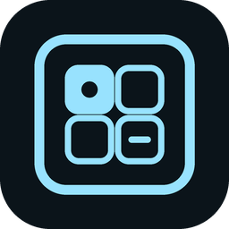
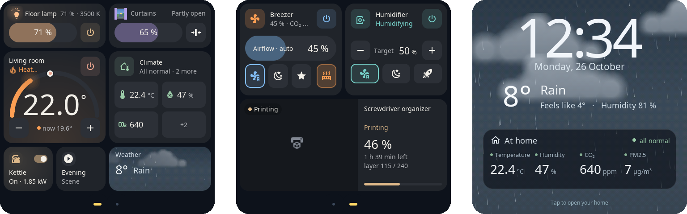
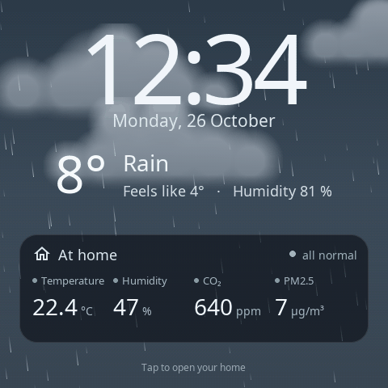
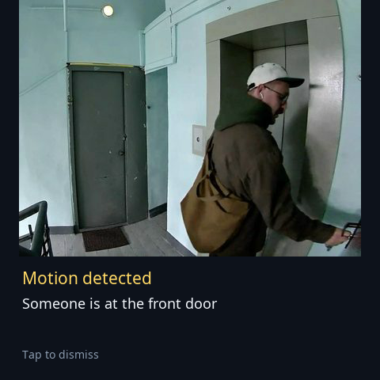

<h1 align="center">S1E Panel — Home Assistant firmware for the Aqara S1E</h1>

  Custom firmware that turns the <b>Aqara Magic Switch S1E</b> (NPD1121WSK01) into a fast, native <b>Home Assistant touch panel</b>.

  <a href="https://alexshemr.github.io/s1e-panel/"><b>▶ Try the live demo</b></a> ·
  <a href="docs/installation.md">Install</a> ·
  <a href="docs/cards.md">Cards</a> ·
  <a href="docs/getting-started.md">Getting started</a> ·
  <a href="README.ru.md">Русский</a>

  

S1E Panel replaces the factory interface of the Aqara S1E wall panel with its own native UI, built for Home Assistant. It runs on the panel's own Linux system and stock kernel, draws everything with [LVGL](https://lvgl.io) at the panel's full 480 × 480 resolution and talks to Home Assistant over your local network — so the panel can show and control the lights, curtains, climate devices, sensors and other entities you already have in Home Assistant, not only Aqara devices.

> [!IMPORTANT]
> S1E Panel is an independent community project. It is **not** made, endorsed or supported by Aqara or Lumi United Technology. Installing it means opening the device and working on its electronics; read the [safety notice](#safety-and-disclaimer) first.

## Why S1E Panel

- **A real Home Assistant panel.** Lights, curtains and roller blinds, thermostats, humidifiers, fans, breezers, room climate, scenes and scripts, switches, number / select / text helpers, dates and times, weather, media and a 3D printer — straight from your Home Assistant entities.
- **Smooth and responsive.** Native drawing, swipeable pages, animated cards: the lamp glows in its own colour, the curtain moves in a window with a real sky, the fan spins at its real speed.
- **Yours to arrange.** Several pages on an 8 × 8 grid, cards in up to 11 sizes, your colours, icons, captions and the device modes you actually use.
- **Edit from any browser.** A web editor on the panel itself, with a live preview rendered by the same code as the screen. Cards can also be added and moved right on the panel.
- **Screensavers and notifications.** A clock, live weather, your home's vital readings or your photos — or a shuffle of them. Home Assistant can send messages with a weather forecast or a doorbell camera photo.
- **No tokens to copy.** A companion integration connects the panel to Home Assistant: it is discovered on your network and you approve it on the panel's screen.
- **Safe updates over Wi-Fi.** Signed packages, two application slots and an automatic rollback if a new version does not start cleanly.

## See it before you install it

You do not need a panel to try the interface:

| Demo | What you can do |
| --- | --- |
| [**Panel constructor**](https://alexshemr.github.io/s1e-panel/demo/stands/home-stand.html?lang=en&mode=play) | A whole panel screen made of interactive cards. Switch the light, drag sliders, change colour and temperature, open and close the curtains, set the thermostat, rearrange the screen. |
| [**Card gallery**](https://alexshemr.github.io/s1e-panel/gallery.html) | Every card type, live, in its sizes, with the options it supports. |
| [**Web editor**](https://alexshemr.github.io/s1e-panel/demo/editor/?demo&lang=en) | The panel's real editor with demo data. The preview on the right is the **firmware's own renderer compiled to WebAssembly**, so what you see is what the panel draws. |

More about the demos and their limits: [docs/cards.md](docs/cards.md#interactive-demos).

  
  &nbsp;
  

## Supported cards

| | | |
| --- | --- | --- |
| **Light** — brightness, colour temperature, colour, effects | **Curtains** and **Roller blind** — position, stop, open / close | **Thermostat** — target temperature, HVAC modes, presets |
| **Humidifier** — target humidity, modes, water tank | **Fan** — speed steps or smooth, oscillation, direction | **Breezer** — airflow, modes, heater, air quality |
| **Climate** — temperature, humidity, CO₂, PM2.5 and more on one card | **Switch / Relay / Action** — switches, the panel's relays, scenes and scripts | **Time** and **Date and time** — `input_datetime` helpers, set with scroll drums |
| **Number**, **Select**, **Text** — Home Assistant helpers | **Weather** — animated sky for every condition | **3D printer** — Bambu Lab print status and live camera |
| **Media** — play / pause and volume | **Reading** and **Readings** — sensor values | |

Pictures of every card in every size, rendered by the firmware: **[docs/cards.md](docs/cards.md)**.

## Install

> [!WARNING]
> The first installation needs a USB-UART adapter, opening the panel and a soldered connection to its service console. It is done once; after that every update arrives over Wi-Fi.
>
> With S1E Panel installed, the panel is controlled by Home Assistant; the factory Aqara software and the Aqara Home app no longer drive it. The factory system is kept and can be restored.

1. **Check your panel:** Aqara Magic Switch S1E, model **NPD1121WSK01**.
2. **Get console access** — the wiring and bootloader access as documented by [oopuuu](https://github.com/oopuuu/AqaraS1E-Custom-GUI) and [niceboygithub](https://github.com/niceboygithub/AqaraSmartSwitchS1E).
3. **Run the installer** `s1e_install.py` with the `s1e-panel-first-install.tar.gz` bundle — both from the [latest release](https://github.com/alexshemr/s1e-panel/releases/latest). It checks the panel, installs S1E Panel next to the factory system, puts the S1E Panel logo on the start-up screen, test-starts the panel and only then makes the installation permanent.
4. **Connect Home Assistant** with the [S1E Panel integration](https://github.com/alexshemr/ha-s1e-panel) (HACS) and add your first card.

Step by step: **[Installation guide](docs/installation.md)** → **[Getting started](docs/getting-started.md)**.

## Documentation

| | |
| --- | --- |
| [Installation guide](docs/installation.md) | From a factory panel to S1E Panel: tools, wiring, installer, recovery |
| [Getting started](docs/getting-started.md) | Wi-Fi, Home Assistant, the web editor and your first card |
| [Supported cards](docs/cards.md) | Every card: entities, controls, sizes and states |
| [Configuration](docs/configuration.md) | Pages, appearance, screensavers, notifications, screen, relays, updates |
| [How it works](docs/architecture.md) | What runs on the panel and how it talks to Home Assistant |
| [Troubleshooting](docs/troubleshooting.md) | Common problems and what to do |
| [Local API](API.md) | HTTPS API for your own scripts and automations |
| [Credits & licenses](docs/credits.md) | The projects S1E Panel is built on |

## Requirements

- Aqara Magic Switch S1E, model **NPD1121WSK01**.
- Home Assistant **2026.10.1** or newer with the [S1E Panel integration](https://github.com/alexshemr/ha-s1e-panel) (HACS).
- A Wi-Fi network (WPA2 password) on which the panel and Home Assistant can reach each other.
- For the first installation: a computer with Python 3.9+, a 3.3 V USB-UART adapter and soldering tools.

## Safety and disclaimer

S1E Panel is an independent, unofficial project, not affiliated with Aqara or Lumi United Technology. Opening and modifying the device may void its warranty. Mistakes during the installation can damage the panel or leave it unable to start. The Aqara S1E is a mains-powered device: never open it or work on it while it is connected to mains, and follow the safety rules for electrical work and soldering. You carry out every step at your own risk. The authors do not guarantee a successful installation and, to the extent permitted by applicable law, accept no liability for damage resulting from modifying the device.

## Credits

The first installation relies on the console access documented by **[oopuuu/AqaraS1E-Custom-GUI](https://github.com/oopuuu/AqaraS1E-Custom-GUI)** and **[niceboygithub/AqaraSmartSwitchS1E](https://github.com/niceboygithub/AqaraSmartSwitchS1E)** — equal thanks to both. The weather scenes take visual cues from [flutter_weather_bg](https://github.com/xiaweizi/flutter_weather_bg) by xiaweizi. S1E Panel is built with LVGL, libwebsockets, Mbed TLS, nlohmann/json, YAJL, React, Noto Sans and Material Design Icons. Full list with licenses: [docs/credits.md](docs/credits.md).

## License

MIT for S1E Panel's own code ([LICENSE](LICENSE)); bundled libraries keep their own licenses. Factory firmware is not distributed.
