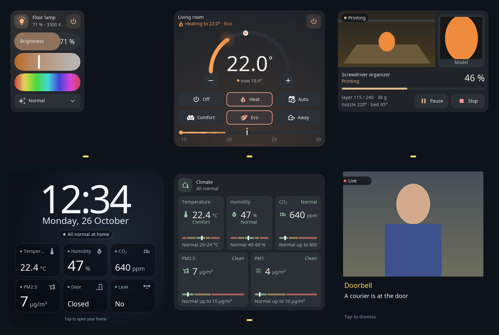

# S1E Panel

Open firmware that turns the **Aqara S1E** wall panel (model **NPD1121WSK01**) into a fast, native Home Assistant dashboard. It runs on the panel's own Linux system, keeps the stock kernel and draws everything with LVGL at the panel's full 480 × 480 resolution.

## Features

- **Cards for your home:** light (brightness, colour temperature, colour, effects), curtains and roller shades, thermostat, humidifier, fan, breezer, room climate, readings, buttons and scenes, number / select / text inputs, date and time, weather, media and a 3D printer card (Bambu Lab).
- **Your modes, your icons:** pick which device modes and presets show on a card, their order, icon and caption.
- **Pages you swipe through,** edited in a browser on your phone or computer: drag cards, change sizes, colours and templates. The browser shows a live preview rendered by the same code as the panel.
- **Screensavers:** clock, weather, home readings, your photos, or a shuffle of them on a schedule. Home Assistant automations can switch them.
- **Notifications** from Home Assistant: text, weather forecasts, and **photos** — a doorbell camera snapshot when someone rings, kept live while the message is on screen.
- **Live cameras** on cards (for example the 3D printer's camera), tap for full screen.
- **Russian and English** interface.
- **Safe updates** over Wi-Fi: signed packages, two application slots and automatic rollback if a new version does not start cleanly.

## Home Assistant

Install the companion integration **S1E Panel** through HACS: add the custom repository [`alexshemr/ha-s1e-panel`](https://github.com/alexshemr/ha-s1e-panel) (category *Integration*), install it and restart Home Assistant. The panel is discovered on your network; confirm the connection on the panel's screen. No Home Assistant token is stored on the panel.

The integration also gives Home Assistant the panel's screen, relays, notifications and screensaver selection, so you can use them in automations. Examples are in the integration's [AUTOMATIONS.md](https://github.com/alexshemr/ha-s1e-panel/blob/main/AUTOMATIONS.md).

## Install and update

Each [release](https://github.com/alexshemr/s1e-panel/releases) contains:

| File | Use |
| --- | --- |
| `s1e-panel-<version>.s1e` | Signed update for a panel that already runs S1E Panel |
| `s1e-panel-first-install.tar.gz` | First installation bundle |
| `SHA256SUMS.txt` | Checksums |

**Updating:** on the panel open **Settings → Panel update → Check → Download → Install**, or upload the `.s1e` file in the web editor (**Settings → Panel update**). The package is verified before installation; if the new version fails to start, the panel returns to the previous one.

**First installation** currently needs service access to the panel's console (UART) and is not yet published as a step-by-step guide. Follow the releases for a guided procedure.

## Using the panel

- Open `https://<panel-ip>:8443` in a browser on the same network. On the panel open **Settings → Pair a device**, type the code shown on the panel and confirm on its screen.
- Swipe left and right between pages; pull down from the top edge for quick settings.
- Hold the screensaver for three seconds to change it.
- **Settings → Language (Язык)** switches the interface language.

For your own integrations, the panel has a local HTTPS API: [API.md](API.md).

## License

MIT for the panel's own code; bundled libraries keep their licenses. Factory firmware and backups are not distributed.

*Not affiliated with Aqara or Lumi United Technology.*
