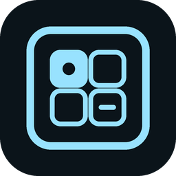
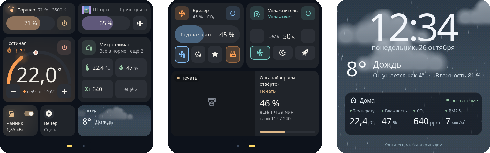
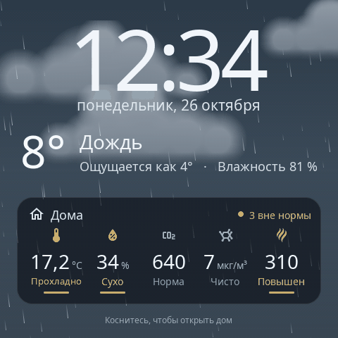
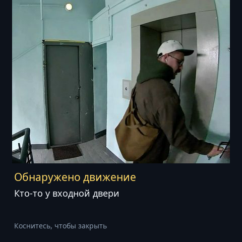

<h1 align="center">S1E Panel — прошивка Home Assistant для Aqara S1E</h1>

  Кастомная прошивка, которая превращает <b>Aqara Magic Switch S1E</b> (NPD1121WSK01) в быструю нативную <b>сенсорную панель Home Assistant</b>.

  <a href="https://alexshemr.github.io/s1e-panel/ru/"><b>▶ Попробовать демо</b></a> ·
  <a href="docs/ru/installation.md">Установка</a> ·
  <a href="docs/ru/cards.md">Карточки</a> ·
  <a href="docs/ru/getting-started.md">Первые шаги</a> ·
  <a href="README.md">English</a>

  

S1E Panel заменяет заводской интерфейс настенной панели Aqara S1E собственным нативным интерфейсом для Home Assistant. Прошивка работает в штатной Linux-системе панели на заводском ядре, рисует всё на [LVGL](https://lvgl.io) в полном разрешении экрана 480 × 480 и связывается с Home Assistant по домашней сети. Панель показывает и управляет светом, шторами, климатической техникой, датчиками и другими сущностями, которые уже есть в вашем Home Assistant, — не только устройствами Aqara.

> [!IMPORTANT]
> S1E Panel — независимый проект сообщества. Он **не** создан, не одобрен и не поддерживается Aqara или Lumi United Technology. Установка требует вскрытия устройства и работы с его электроникой — сначала прочитайте [предупреждение о безопасности](#безопасность-и-отказ-от-ответственности).

## Зачем S1E Panel

- **Настоящая панель Home Assistant.** Свет, шторы и рулонные шторы, термостаты, увлажнители, вентиляторы, бризеры, микроклимат комнаты, сцены и скрипты, выключатели, вспомогательные числа, списки и тексты, дата и время, погода, медиаплеер и 3D-принтер — прямо из ваших сущностей Home Assistant.
- **Плавно и отзывчиво.** Нативная отрисовка, страницы листаются свайпом, карточки анимированы: лампа светится своим цветом, штора движется в окне с настоящим небом, вентилятор крутится с реальной скоростью.
- **Под себя.** Несколько страниц на сетке 8 × 8, карточки до 11 размеров, свои цвета, иконки, подписи и только нужные режимы устройств.
- **Настройка из любого браузера.** Веб-редактор работает на самой панели, а его предпросмотр рисуется тем же кодом, что и экран. Добавлять и переставлять карточки можно и прямо на панели.
- **Заставки и уведомления.** Часы, живая погода, главные показатели дома или ваши фотографии — или всё по очереди. Home Assistant присылает сообщения с прогнозом погоды или снимком с камеры у двери.
- **Никаких токенов.** Панель подключается к Home Assistant через интеграцию: та находит панель в сети, а вы подтверждаете подключение на экране.
- **Безопасные обновления по Wi-Fi.** Подписанные пакеты, два слота приложения и автоматический откат, если новая версия не запустилась.

## Посмотреть до установки

Панель для этого не нужна:

| Демо | Что можно сделать |
| --- | --- |
| [**Конструктор панели**](https://alexshemr.github.io/s1e-panel/demo/stands/home-stand.html?lang=ru&mode=play) | Целый экран панели из живых карточек. Включите свет, подвигайте слайдеры, поменяйте цвет и температуру, откройте шторы, настройте термостат, переставьте карточки. |
| [**Галерея карточек**](https://alexshemr.github.io/s1e-panel/gallery.html?lang=ru) | Все типы карточек вживую, в их размерах и с их настройками. |
| [**Веб-редактор**](https://alexshemr.github.io/s1e-panel/demo/editor/?demo&lang=ru) | Настоящий редактор панели с демонстрационными данными. Предпросмотр справа — **рендерер самой прошивки, скомпилированный в WebAssembly**: вы видите ровно то, что нарисует панель. |

Подробнее о демо и их ограничениях: [docs/ru/cards.md](docs/ru/cards.md#интерактивные-демо).

  
  &nbsp;
  

## Карточки

| | | |
| --- | --- | --- |
| **Свет** — яркость, цветовая температура, цвет, эффекты | **Шторы** и **рулонная штора** — положение, стоп, открыть / закрыть | **Термостат** — целевая температура, режимы, пресеты |
| **Увлажнитель** — целевая влажность, режимы, бак с водой | **Вентилятор** — скорость ступенями или плавно, качание, направление | **Бризер** — подача воздуха, режимы, обогрев, качество воздуха |
| **Микроклимат** — температура, влажность, CO₂, PM2.5 и другие на одной карточке | **Выключатель / реле / действие** — выключатели, реле панели, сцены и скрипты | **Время** и **дата и время** — помощники `input_datetime`, меняются барабанами |
| **Число**, **выбор**, **текст** — вспомогательные сущности Home Assistant | **Погода** — анимированное небо для любой погоды | **3D-принтер** — печать Bambu Lab и камера |
| **Медиаплеер** — пуск / пауза и громкость | **Показание** и **показания** — значения датчиков | |

Все карточки во всех размерах, отрисованные прошивкой: **[docs/ru/cards.md](docs/ru/cards.md)**.

## Установка

> [!WARNING]
> Для первой установки нужны USB-UART-адаптер, вскрытие панели и пайка к её сервисной консоли. Это делается один раз — все последующие обновления приходят по Wi-Fi.
>
> С S1E Panel панелью управляет Home Assistant; заводское ПО Aqara и приложение Aqara Home ею больше не управляют. Заводская система сохраняется, и её можно вернуть.

1. **Проверьте панель:** Aqara Magic Switch S1E, модель **NPD1121WSK01**.
2. **Получите доступ к консоли** — подключение и доступ к загрузчику, как описано у [oopuuu](https://github.com/oopuuu/AqaraS1E-Custom-GUI) и [niceboygithub](https://github.com/niceboygithub/AqaraSmartSwitchS1E).
3. **Запустите установщик** `s1e_install.py` с комплектом `s1e-panel-first-install.tar.gz` — оба из [последнего выпуска](https://github.com/alexshemr/s1e-panel/releases/latest). Он проверяет панель, ставит S1E Panel рядом с заводской системой, ставит логотип S1E Panel на экран включения, запускает панель на пробу и только потом закрепляет установку.
4. **Подключите Home Assistant** через [интеграцию S1E Panel](https://github.com/alexshemr/ha-s1e-panel) (HACS) и добавьте первую карточку.

Пошагово: **[руководство по установке](docs/ru/installation.md)** → **[первые шаги](docs/ru/getting-started.md)**.

## Документация

| | |
| --- | --- |
| [Установка](docs/ru/installation.md) | От заводской панели до S1E Panel: инструменты, подключение, установщик, возврат |
| [Первые шаги](docs/ru/getting-started.md) | Wi-Fi, Home Assistant, веб-редактор и первая карточка |
| [Карточки](docs/ru/cards.md) | Все карточки: сущности, управление, размеры и состояния |
| [Настройка](docs/ru/configuration.md) | Страницы, внешний вид, заставки, уведомления, экран, реле, обновления |
| [Как это устроено](docs/ru/architecture.md) | Что работает на панели и как она общается с Home Assistant |
| [Решение проблем](docs/ru/troubleshooting.md) | Частые проблемы и что делать |
| [Локальный API](docs/ru/api.md) | HTTPS API для своих скриптов и автоматизаций |
| [Благодарности и лицензии](docs/ru/credits.md) | Проекты, на которых построен S1E Panel |

## Что нужно

- Aqara Magic Switch S1E, модель **NPD1121WSK01**.
- Home Assistant **2026.10.1** или новее с [интеграцией S1E Panel](https://github.com/alexshemr/ha-s1e-panel) (HACS).
- Сеть Wi-Fi с паролем (WPA2), в которой панель и Home Assistant видят друг друга.
- Для первой установки: компьютер с Python 3.9+, USB-UART-адаптер на 3,3 В и паяльник.

## Безопасность и отказ от ответственности

S1E Panel — независимый неофициальный проект, не связанный с Aqara или Lumi United Technology. Вскрытие и модификация устройства могут лишить вас гарантии. Ошибки при установке могут повредить панель или сделать её неработоспособной. Aqara S1E питается от сети 220 В: никогда не вскрывайте её и не работайте с ней, пока она подключена к сети, и соблюдайте правила безопасности при работе с электричеством и пайке. Все действия вы выполняете на свой страх и риск. Авторы не гарантируют успешную установку и в пределах, допускаемых применимым законодательством, не несут ответственности за последствия модификации устройства.

## Благодарности

Первая установка опирается на доступ к консоли, описанный в **[oopuuu/AqaraS1E-Custom-GUI](https://github.com/oopuuu/AqaraS1E-Custom-GUI)** и **[niceboygithub/AqaraSmartSwitchS1E](https://github.com/niceboygithub/AqaraSmartSwitchS1E)** — одинаковое спасибо обоим. Погодные сцены вдохновлены [flutter_weather_bg](https://github.com/xiaweizi/flutter_weather_bg) от xiaweizi. S1E Panel построен на LVGL, libwebsockets, Mbed TLS, nlohmann/json, YAJL, React, Noto Sans и Material Design Icons. Полный список с лицензиями: [docs/ru/credits.md](docs/ru/credits.md).

## Лицензия

Собственный код S1E Panel — MIT ([LICENSE](LICENSE)); встроенные библиотеки сохраняют свои лицензии. Заводская прошивка не распространяется.
