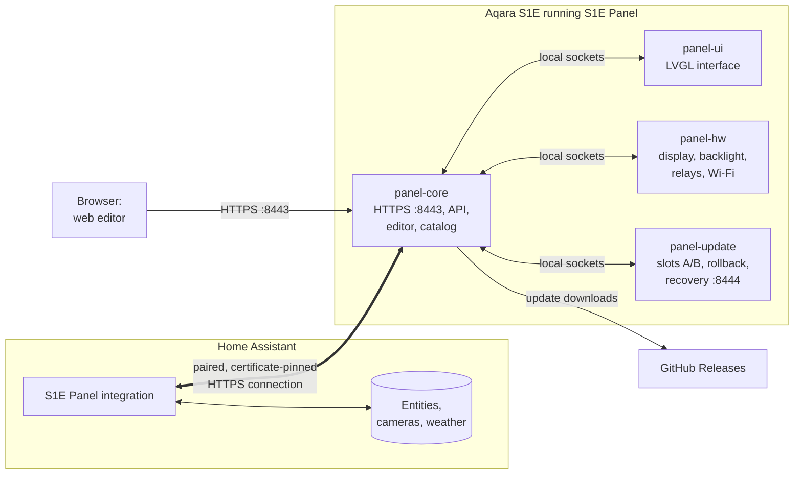

# How S1E Panel works

[Русская версия](ru/architecture.md) · [← Back to README](../README.md)

A short tour of what runs on the panel, how it talks to Home Assistant and where your settings live.

## On the panel

S1E Panel is an application for the panel's own Linux system. It keeps the factory kernel and drivers and replaces only the user interface and its services.

| Process | Job |
| --- | --- |
| **panel-ui** | Draws the interface with LVGL at 480 × 480 and handles touch gestures. It has no network access. |
| **panel-core** | The centre: configuration, the Home Assistant connection, the entity catalog, commands, notifications, pairing, the HTTPS server for the editor and the [local API](../API.md), update downloads. |
| **panel-hw** | Hardware: the display (through the factory display driver), backlight, relays, Wi-Fi settings. |
| **panel-update** | The updater, separate from the application: verifies signed packages, switches between application slots, rolls back a failed update, and keeps a small recovery service on port 8444 even if the application does not start. |

The processes talk over local sockets. Graphics are separated from the network: a fault in one part does not take the others down, and the updater survives a broken application.

**The factory Aqara software does not run** while S1E Panel is active: the panel is no longer driven by the Aqara Home app or Aqara's cloud services. Its relays, screen and sensors are used by S1E Panel and Home Assistant instead.

## Start-up

1. The bootloader shows the start-up picture for a moment (the S1E Panel logo after installation) and starts the factory kernel with S1E Panel's boot arguments: they mount the data volume and run S1E Panel's start script. If that script cannot run, the factory system starts instead.
2. The start script loads the factory display and Wi-Fi drivers, joins Wi-Fi and starts the updater.
3. The updater starts the application from the active slot (A or B).

## Talking to Home Assistant

- **Discovery:** the panel announces itself on the local network over mDNS (`_s1e-panel._tcp`) with its id and certificate fingerprint. The integration finds it there, or you type its address.
- **Pairing:** the integration asks to connect, and you approve it on the panel's screen. Home Assistant keeps a key; the panel keeps only its hash. The panel's certificate fingerprint is pinned at first contact; a changed certificate is not silently accepted.
- **No token on the panel:** the integration opens its own encrypted connection to the panel and serves it what the cards need. The panel never receives a Home Assistant token and never logs in to Home Assistant.
- **Entities and states:** the integration sends the entity catalog (names, areas, devices, capabilities) and then state changes as they happen. The panel also gets the time, the time zone and weather forecasts this way.
- **Commands:** a touch on a card becomes a command (for example `light.turn_on` with a brightness) sent to Home Assistant over the same connection. The card shows the new state at once and confirms it when Home Assistant reports it; if the device does not follow, the card returns to the real state. Only entities on the panel's cards, and only the actions their cards use, are accepted.
- **Pictures:** for camera frames, the 3D printer's model picture and photos in messages, Home Assistant takes the snapshot, fits it to the screen and sends a JPEG. Only cameras on the panel's cards or passed to `show_message` can be read.

## The web editor

The editor is a web app served by the panel itself on `https://<panel-ip>:8443`. Its preview runs **the same LVGL interface code compiled to WebAssembly**, so the preview and the screen match pixel for pixel. Saving sends the whole configuration with its revision number: if someone changed it meanwhile (on the panel or in another browser), the editor is told instead of overwriting their changes.

## Where settings are stored

Everything lives in one folder on the panel's existing data volume, `/data/s1e-panel`:

| | |
| --- | --- |
| `releases/A`, `releases/B` | Two application slots: the current version and the previous or next one |
| `data/` | Your configuration (pages, cards, screensavers, screen, relays), paired clients, the HTTPS certificate, uploaded photos, Wi-Fi settings |
| `system/` | The updater, the trusted public key for updates and the start scripts; an application update cannot change them |

Configuration changes are written atomically, so a power cut never leaves a half-written file. Before trying a new version, the updater takes a snapshot of `data/`; if the new version fails, both the application and the data go back.

## Notifications and weather

- **Notifications** arrive from Home Assistant (`s1e_panel.show_message`) or the local API. A high-priority message interrupts what is on screen; a normal one waits until the panel is idle. A message can carry a weather forecast item or a photo.
- **Weather** comes from a Home Assistant `weather` entity. The panel draws the weather scenes itself — one scene per Home Assistant condition, day and night, with rain, snow, fog and lightning particles — on the weather card, the Living weather screensaver and weather messages. No weather service is contacted by the panel.

## Network and permissions

| Direction | What | Why |
| --- | --- | --- |
| In: TCP 8443 (HTTPS) | Web editor, local API, Home Assistant connection | Paired clients only (except the public info and pairing endpoints) |
| In: TCP 8444 (HTTPS) | Updater's recovery service | Paired clients only |
| mDNS | `_s1e-panel._tcp` announcement | Discovery by the integration |
| Out: HTTPS to GitHub | `api.github.com`, `github.com` and GitHub's file storage | Checking and downloading updates, only when you ask |

The panel needs no cloud service and no internet access for everyday use; internet is used only for updates from GitHub. Home Assistant must be able to reach the panel on port 8443.

## Is an extra Home Assistant integration needed?

Yes: the **S1E Panel integration** (HACS: [alexshemr/ha-s1e-panel](https://github.com/alexshemr/ha-s1e-panel)). It is what gives the panel your entities without a token and gives Home Assistant the panel's screen, relays, screensaver and notifications. No other add-ons, MQTT broker or YAML are needed.
