# Supported cards

[Русская версия](ru/cards.md) · [← Back to README](../README.md) · [**Interactive gallery**](https://alexshemr.github.io/s1e-panel/gallery.html)

Every card type in the current release, with the Home Assistant entities it accepts, its controls and its sizes. All pictures are cut at 1:1 from frames rendered by the firmware's own renderer, so a card here is exactly as large as on the 480 × 480 screen.

**Sizes** are in grid cells: the screen is an 8 × 8 grid, so `4×4` is a quarter of the screen and `8×8` the whole page. Each card adapts its layout to its size: larger cards show more controls.

**Common options** for every card (editor → card → **Card settings**): name, icon (any of the 7 000+ Material Design Icons), accent colour (per card or per device type), and for cards with several controls, which controls and device modes are shown and in what order.

| Card | Home Assistant entities | Sizes |
| --- | --- | --- |
| [Light](#light) | `light` | 11: 2×2 … 8×8 |
| [Curtains](#curtains-and-roller-blind) | `cover` | 11 |
| [Roller blind](#curtains-and-roller-blind) | `cover` | 11 |
| [Thermostat](#thermostat) | `climate` | 11 |
| [Air conditioner](#air-conditioner) | `climate` | 9: 2×2 … 8×6 |
| [Humidifier](#humidifier) | `humidifier` | 11 |
| [Fan](#fan) | `fan` | 11 |
| [Breezer](#breezer) | `fan` + air sensors | 11 |
| [Climate](#climate) | `sensor` (several) | 11 |
| [Switch](#switch-relay-and-action) | `switch`, `input_boolean` | 2×2, 2×4, 4×2 |
| [Relay](#switch-relay-and-action) | the panel's own relays | 2×2, 2×4, 4×2 |
| [Action](#switch-relay-and-action) | `scene`, `script`, `button`, `input_button` | 2×2, 2×4, 4×2 |
| [Time](#time-and-date-and-time) | `input_datetime` | 2×4, 4×2, 4×4, 8×2 |
| [Number](#number-select-and-text) | `number`, `input_number` | 2×2, 2×4, 4×2, 4×4, 8×2 |
| [Select](#number-select-and-text) | `select`, `input_select` | 2×2, 2×4, 4×2, 4×4, 8×2 |
| [Text](#number-select-and-text) | `text`, `input_text` | 4×2, 4×4, 8×2, 8×4 |
| [TV](#tv) | `media_player` + `remote`, `number` | 11 |
| [Weather](#weather) | `weather` | 11 |
| [3D printer](#3d-printer) | Bambu Lab printer sensors | 9 |
| [Reading, Binary sensor](#reading-readings-and-binary-sensor) | `sensor`, `binary_sensor` | 10 |

"11" means all sizes: 2×2, 2×4, 2×6, 2×8, 4×2, 4×4, 4×6, 8×2, 8×4, 8×6, 8×8. "10" is the same without 8×4.

## Interactive demos

The [interactive gallery](https://alexshemr.github.io/s1e-panel/gallery.html) and the [panel constructor](https://alexshemr.github.io/s1e-panel/demo/stands/home-stand.html?lang=en&mode=play) let you use each card in a browser, with simulated devices: no Home Assistant and no panel needed.

What they are, honestly:
- **Card demos** are the interactive reference designs ("stands") every firmware card is built from and checked against: same layout rules for every size, same colours, texts and behaviour. The firmware draws them natively with LVGL; a few animations are simplified on the panel (for example glows are drawn as a tint instead of "breathing").
- **The web editor demo** shows the panel's real editor with the **firmware's renderer compiled to WebAssembly** — the preview there is pixel-for-pixel what the panel draws. Its preview is for arranging cards; touches select cards instead of operating devices.
- Devices are simulated: state changes stay in your browser.

---

## Light

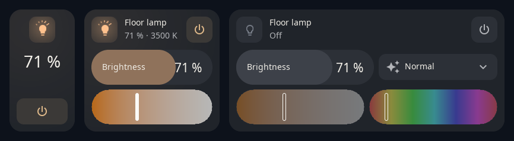

Brightness, colour temperature, colour and effects of a Home Assistant `light`, plus quick brightness presets. The card shows only what the lamp supports; you can hide any of these blocks. The lamp icon glows in the light's current colour.

- **Controls:** on / off, brightness slider, colour temperature, colour, effect list (shown as "modes"), quick presets.
- **States:** on (glow in the lamp's colour), off, unavailable; day and night variants.
- **Try it:** [light card demo](https://alexshemr.github.io/s1e-panel/demo/stands/light-stand.html?lang=en)

## Curtains and roller blind

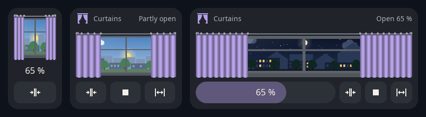
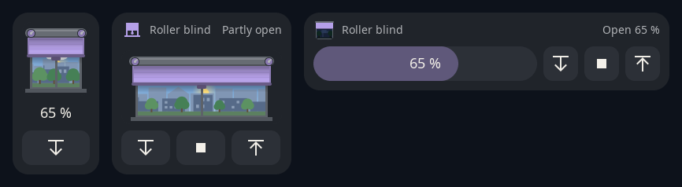

Two looks for a Home Assistant `cover`: curtains that slide aside, or a roller blind that comes down from its box. Behind them is a window with a city and a sky that follows the real sun and moon.

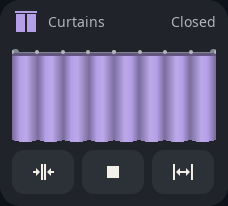

- **Controls:** position slider, open, stop, close. The card follows the real motion of the cover; with the full opening and closing times set in the editor, the animation matches your motor.
- **Blocks you can hide:** position, stop, the window scene, the buttons.
- **States:** open, partly open, closed, opening / closing, unavailable; day and night.
- **Try it:** [curtains](https://alexshemr.github.io/s1e-panel/demo/stands/cover-stand.html?lang=en) · [roller blind](https://alexshemr.github.io/s1e-panel/demo/stands/roller-stand.html?lang=en)

 

## Thermostat

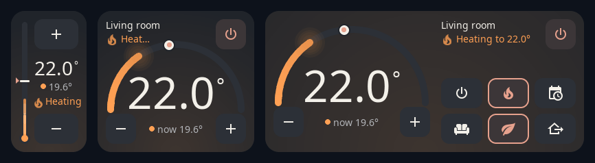

Target temperature of a Home Assistant `climate` entity with − and + (hold to repeat). You see at a glance whether it is heating: a flame and a warm glow.

- **Layout:** a thermometer on narrow cards, a half-circle gauge from 4×4, HVAC modes and presets on larger cards.
- **Controls:** −/+, on / off, HVAC modes and presets from the entity (you choose which, in which order, with which icon and caption).
- **States:** heating, idle, off, unavailable.
- **Try it:** [thermostat demo](https://alexshemr.github.io/s1e-panel/demo/stands/thermostat-stand.html?lang=en)

## Air conditioner

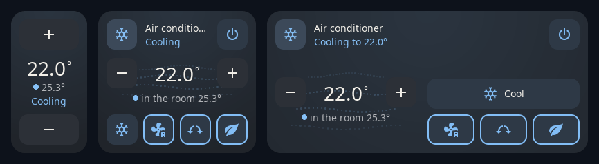

A Home Assistant `climate` entity that cools: cool, heat, dry, fan and auto. The card takes the colour of the mode (cold blue, warm orange, teal for drying) and air flows from the vent while the unit works — faster on a higher fan speed, sideways while the vanes swing.

- **Layout:** the target between − and + over the vent air; on 8×4 a large target on the left, the rows on the right.
- **Controls:** −/+ (hold to repeat), on / off, the HVAC modes as a row of icons, fan speed (`fan_modes`, the automatic one first), swing (`swing_modes`) and presets (`preset_modes`) when the entity has them. On a card too small for all the rows, fan, swing and preset become one row of buttons that each step through their choices.
- **Entities of their own:** many units expose fan speed, swing or presets as separate entities. In **Card settings** bind **Fan speed** and **Presets** to a `select`, and **Swing** to a `switch` or a `select`; the card then reads and sets those.
- **Choices:** pick which modes, fan speeds and presets show, in which order, with which icon and caption.
- **States:** cooling, heating, drying, ventilating, holding the temperature, off, unavailable.
- **Try it:** [air conditioner demo](https://alexshemr.github.io/s1e-panel/demo/stands/ac-stand.html?lang=en)

## Humidifier

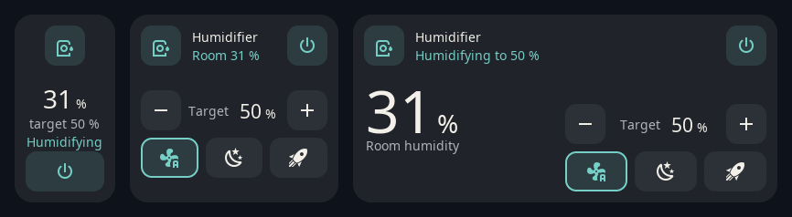

Target humidity of a Home Assistant `humidifier` in 5 % steps, with mist rising while it works.

- **Controls:** −/+, on / off, modes from the entity.
- **Water tank (optional):** bind a water level sensor or a "no water" `binary_sensor` to show the tank.
- **States:** humidifying, idle, off, tank empty, unavailable.
- **Try it:** [humidifier demo](https://alexshemr.github.io/s1e-panel/demo/stands/humidifier-stand.html?lang=en)

## Fan

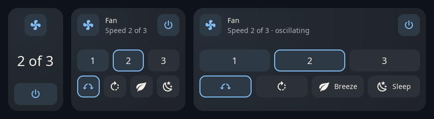

A Home Assistant `fan`: speed in steps (3–6 speeds) or smoothly with a slider, oscillation, direction and presets. The impeller spins at the real speed.

- **Try it:** [fan demo](https://alexshemr.github.io/s1e-panel/demo/stands/fan-stand.html?lang=en)

## Breezer

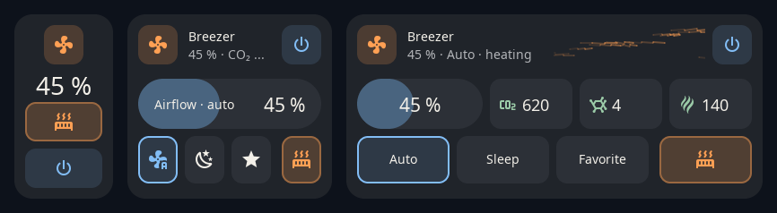

A supply ventilation unit (a `fan` entity) with everything around it on one card: airflow, preset modes (for example Auto, Sleep, Favorite), the heater, and up to three air sensors (CO₂, PM2.5, TVOC) coloured by level.

- **Bindings:** the fan, an optional heater switch, up to three sensors.
- **Try it:** [breezer demo](https://alexshemr.github.io/s1e-panel/demo/stands/breezer-stand.html?lang=en)

## Climate

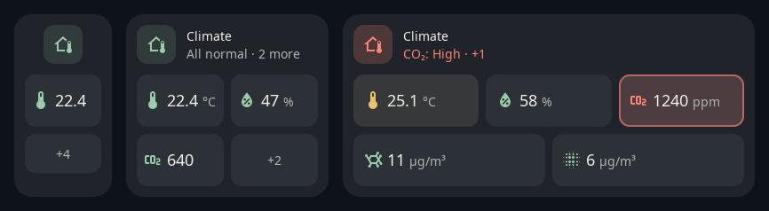

The room's readings on one card: temperature, humidity, CO₂, PM2.5, PM1 and more (up to six sensors). Colours show whether each value is within its norm; values out of norm are highlighted, and the header sums it up (for example *All normal*).

- **Layout:** compact tiles, tiles with a scale, or detailed tiles with the norm range, depending on the size. Tap a small tile to see its details.
- **Try it:** [climate demo](https://alexshemr.github.io/s1e-panel/demo/stands/climate-stand.html?lang=en)

## Switch, relay and action

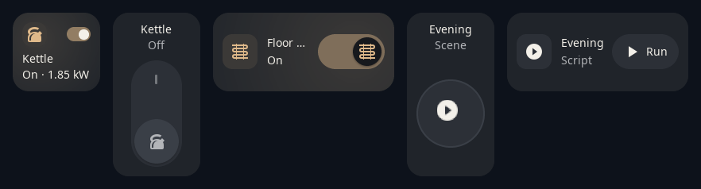

One-touch cards: the whole card is the button.

- **Switch** — a `switch` or `input_boolean`: a small toggle on 2×2, a wall rocker on 2×4, a rocker on its side on 4×2. Optionally shows a power reading next to "On", e.g. *On · 1.85 kW*.
- **Relay** — one of the panel's three built-in relays (works even without Home Assistant).
- **Action** — a `scene`, `script`, `button` or `input_button`: a round button or a *Run* pill; the rim runs while a script is running, a check mark confirms.
- **Try it:** [switch, relay and action demo](https://alexshemr.github.io/s1e-panel/demo/stands/button-stand.html?lang=en)

## Time and Date and time

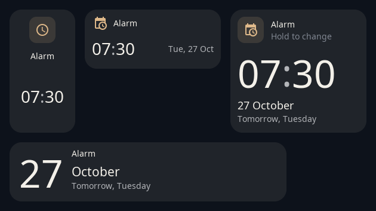

For `input_datetime` helpers such as an alarm, a reminder or a deadline.

- **Time:** clock and date variants for 2×4, 4×2, 4×4 and 8×2. Hold the hours, minutes or the date to open scroll drums; **Done** saves the new value to Home Assistant, **Cancel** (or 10 seconds without a touch) closes them.
- **Try it:** [time demo](https://alexshemr.github.io/s1e-panel/demo/stands/time-stand.html?lang=en)

## Number, select and text

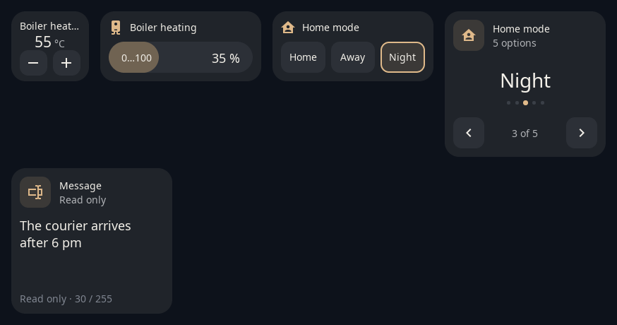

Home Assistant helpers and device settings:

- **Number** (`number`, `input_number`): − / + buttons or a slider, depending on the entity's mode.
- **Select** (`select`, `input_select`): buttons for a few options, arrows with dots for many.
- **Text** (`text`, `input_text`): shows the text and how long ago it changed — a message board for the family.
- **Try it:** [number, select and text demo](https://alexshemr.github.io/s1e-panel/demo/stands/inputs-stand.html?lang=en)

## TV

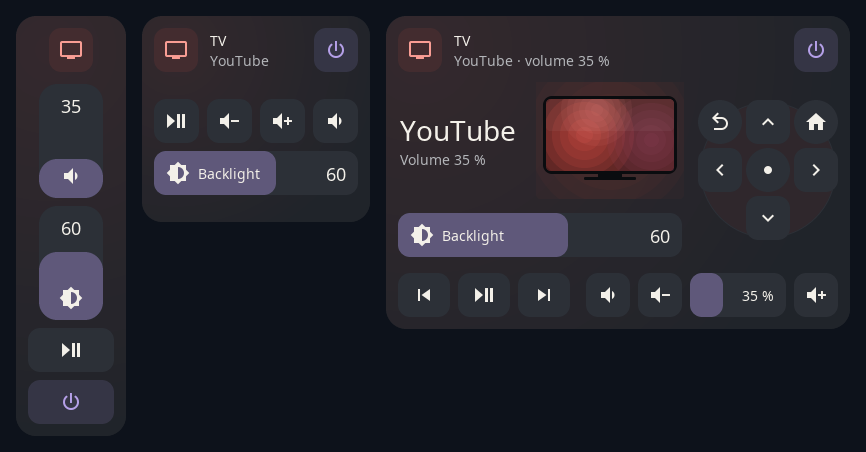

A TV through the Home Assistant **Android TV Remote** integration: power, play/pause, skip, volume with − and + (hold to repeat) or a bar, mute, the apps set in the integration's options and the remote's d-pad with Back and Home. The screen on the card glows in the colour of the running app.

- **Binding:** the TV's `media_player`. In the card settings: **Remote** — the `remote` entity of the same TV for the d-pad; **Screen backlight** — any `number` that sets the backlight, e.g. a script-backed `number.xiaomi_tv_screen_backlight`. Both are optional; **Apps on the card** hides the app row.
- **Layout:** 2×2 turns the TV on and off; 2×N is a column with vertical volume and backlight bars; 4×2 and 8×2 a row of buttons; from 4×4 rows for the keys, volume, backlight and apps; the d-pad on 8×6 and 8×8.
- **States:** on with the app and volume, muted, off (the controls rest), unavailable. Android TV does not report playing or paused, so play and pause is one button.
- **Needs** the S1E Panel integration 0.5.4 or newer (firmware 0.8.8) (volume steps, apps, remote keys).
- **Try it:** [TV demo](https://alexshemr.github.io/s1e-panel/demo/stands/media-stand.html?lang=en)

## Weather

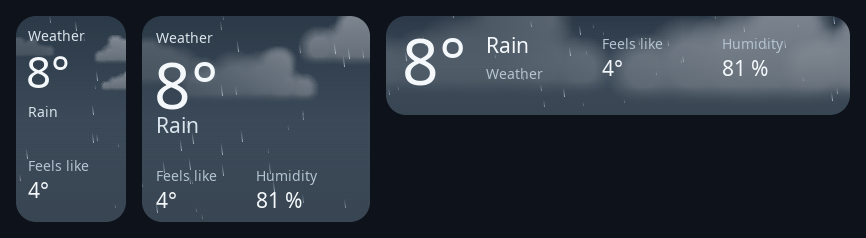

A Home Assistant `weather` entity on an animated sky: every weather condition has its own scene, by day and by night, with temperature, condition, feels-like and humidity on larger cards. The same scenes run on the weather screensaver and on weather notifications.

A tap on the card opens the forecast over the whole screen: the live sky and the next hours in six 3-hour windows with an icon, the temperature and the chance of rain. A window shows the most serious weather of its three hours: one rainy hour makes it rainy. Tap a window to see its sky. The forecast is the entity's hourly forecast.

- **Try it:** [weather demo](https://alexshemr.github.io/s1e-panel/demo/stands/weather-stand.html?lang=en)

## 3D printer

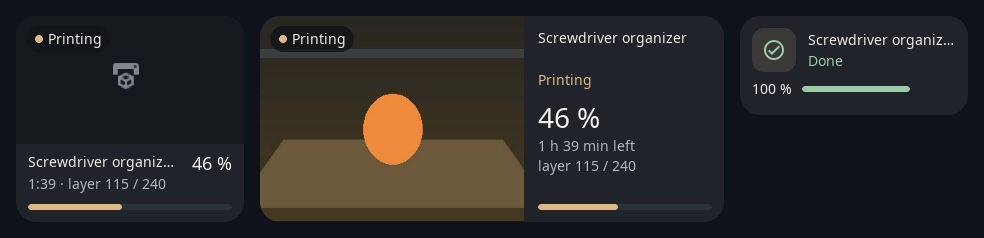

The current print of a Bambu Lab printer connected to Home Assistant with [ha-bambulab](https://github.com/greghesp/ha-bambulab): status, model name, progress and time left; on larger cards the layer, weight, nozzle and bed temperatures, **Pause** and **Stop**, the printer's camera and the slicer's picture of the model.

- **Binding:** choose the printer's `print_status` sensor; the other sensors are found by the printer's prefix.
- **Camera:** a new frame every 2 seconds on the card; tap it for full screen (a frame every second). Needs the S1E Panel integration 0.5.0 or newer.
- **States:** preparing, printing, paused, finished, failed, idle, off.
- **Try it:** [3D printer demo](https://alexshemr.github.io/s1e-panel/demo/stands/printer-stand.html?lang=en)

## Reading, Readings and Binary sensor

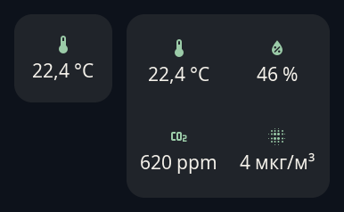

Simple value tiles for `sensor` and `binary_sensor` entities: **Reading** shows the value, **Binary sensor** its state in a word (*Open*, *Closed*, *Leak*, *Motion*…). The icon comes from the entity, the card or, without either, the kind of reading. For room readings with norms and colours, use the [Climate](#climate) card.

---

## Screensavers

Not cards, but part of the screen: see [Configuration → Screensavers](configuration.md#screensavers).

| Just the time | Home essentials | Living weather | A favorite moment | The Moon |
| --- | --- | --- | --- | --- |
| 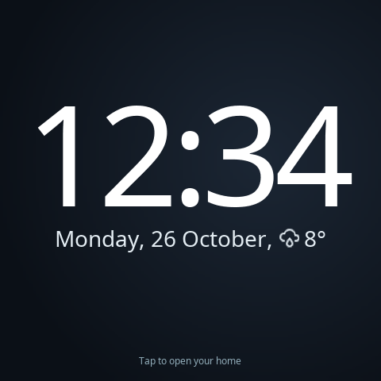 | 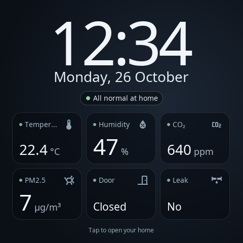 | 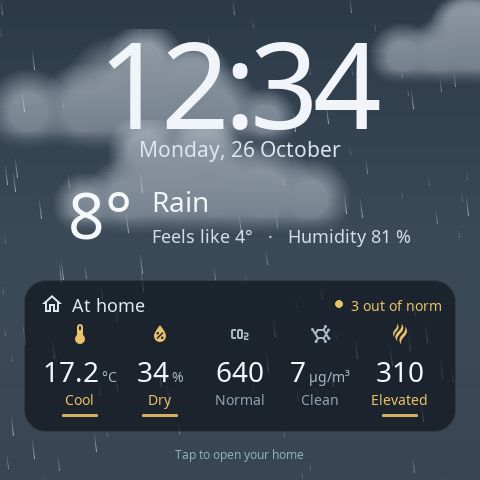 | 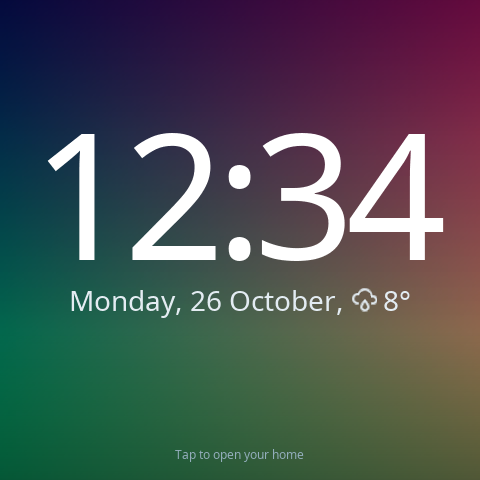 | 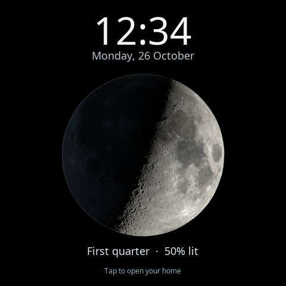 |

[Try the screensavers](https://alexshemr.github.io/s1e-panel/demo/stands/saver-stand.html?lang=en)
