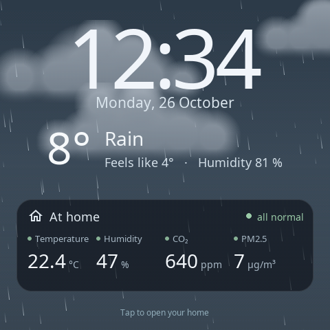
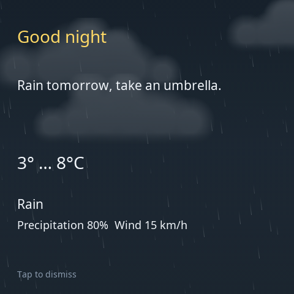
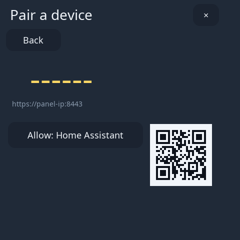

# Configuration

[Русская версия](ru/configuration.md) · [← Back to README](../README.md)

Everything here is set in the web editor (`https://<panel-ip>:8443`) and most of it also on the panel (pull down from the top edge → **Settings**). Changes in the editor are applied when you click **Save**; the editor keeps an **Undo** for your edits.

## Pages and layout

- **Pages:** the tabs above the preview. **+** adds a page; the page settings on the right rename or delete it. On the panel, swipe left and right between pages.
- **Grid:** each page is 8 × 8 cells. Cards take 2×2 up to 8×8 cells (see [card sizes](cards.md)). Drag a card in the preview to move it; choose its **Size** in **Card settings**; a card that does not fit is refused, not overlapped.
- **Card actions:** duplicate, delete, move to another page.
- **On the panel:** hold a card for 3 seconds to move, resize or delete it; **Add** in the pull-down menu adds a device.
- **Backup:** **Settings → Export** saves the whole configuration (pages, cards, screensavers, screen, relays) as `s1e-panel.json`; **Import** loads it back. Photos and secrets are not part of the file.

## Appearance

- **Language:** English or Russian, for the panel and the editor (**Settings → Language (Язык)** on the panel, or in the editor's settings).
- **Colours:** a primary accent colour, a colour per device type (**Colors by device type**) and, if you want, a colour for a single card (**Card accent**).
- **Icons:** any Material Design Icon for a card (**MDI icon**), with search.
- **Card contents:** for each card, which controls are shown, which device modes and presets appear, their order, icon and caption.
- **Reduce motion:** replaces animations with calm static versions (also the start-up animation).

## Screensavers

The screensaver appears after the **idle timeout** and goes away on a touch.

| Screensaver | What it shows | Settings |
| --- | --- | --- |
| **Just the time** | A large clock and the date with today's weather | Weather source, background photo |
| **Home essentials** | The clock and up to six home readings coloured by their norms (doors and leaks too), with a short verdict | Sensors and their order |
| **Living weather** | The clock over an animated sky of the current weather, with a "At home" tile of four readings | Weather source, sensors |
| **A favorite moment** | Your photos as a slide show with the clock and the weather | Photos, slide interval |
| **Shuffle** | Takes turns between the screensavers you choose, in turn or at random | Which ones, every 1 min … 3 h |

- **Photos** are uploaded in the editor's screensaver settings (**Upload photo**) and stored on the panel (up to 5 MiB in total).
- **On the panel:** hold the screensaver for 3 seconds to pick another one.
- **From Home Assistant:** the integration's **Screensaver** select entity (`clock`, `sensors`, `weather`, `photo`, `shuffle`) switches it in automations — for example the Home essentials screensaver while the air is poor.

 

## Screen

| Setting | Meaning |
| --- | --- |
| **Brightness** | Backlight level; also in the pull-down menu on the panel |
| **Idle timeout, sec** | Time without a touch before the screensaver |
| **Then turn off, sec** | Optional: turn the screen off this many seconds later (0 = never) |
| **Scheduled sleep** | **Sleep at** / **Wake at**: the screen stays dark at night |

Home Assistant gets the screen as a **light** entity (on / off and brightness) and the night mode as a **binary sensor**, so the screen can follow presence or a "good night" scene. A screen-off or night mode set from Home Assistant takes priority over the screensaver.

## Notifications

Home Assistant sends messages to the panel with the integration's action **`s1e_panel.show_message`**:

- title, text, icon and type (`info`, `success`, `warning`, `error`);
- **priority:** `high` shows it at once over anything; `normal` waits until the panel is idle;
- how long it stays on screen and how long it stays relevant;
- a **weather forecast** item from Home Assistant, shown on the animated sky of that weather;
- a **photo** from a `camera.*` or `image.*` entity, optionally refreshed every second while shown (`live`) — a doorbell camera, for example.

`s1e_panel.dismiss_notification` and `s1e_panel.clear_notifications` remove messages; on the panel a tap dismisses them. The editor has a **Test notification** button. Ready-made automations (doorbell, tomorrow's weather, presence): [AUTOMATIONS.md](https://github.com/alexshemr/ha-s1e-panel/blob/main/AUTOMATIONS.md). For scripts without Home Assistant, the same is available through the [local API](../API.md#notifications).

 

## Relays

The NPD1121WSK01 has three relays, the panel's own outputs.

- **Names** and the **Relay power-on state** after a power cut: `last` (restore), `off` or `on`.
- Use a **Relay** card on a page, or the relay **switch** entities in Home Assistant.
- The panel reports the state it set on its outputs; it does not measure whether a connected load actually draws power.

## Home Assistant integration

The [S1E Panel integration](https://github.com/alexshemr/ha-s1e-panel) gives the panel your entities and gives Home Assistant:

| Entity / action | Use |
| --- | --- |
| Screen (`light`) | On / off and brightness |
| Night mode (`binary_sensor`) | Whether scheduled sleep is active |
| Relays (`switch`) | The three relays |
| Screensaver (`select`) | Which screensaver is shown |
| Diagnostics | Connection and health of the panel |
| `s1e_panel.show_message`, `dismiss_notification`, `clear_notifications` | Messages on the screen |

Only entities that are on the panel's cards can be controlled from the panel, and only with the actions those cards use.

## Updates

- **Over Wi-Fi:** on the panel **Settings → Panel update → Check for updates → Download → Install**, or the same in the editor. The panel downloads the release from GitHub itself.
- **From a file:** download `s1e-panel-<version>.s1e` from [Releases](https://github.com/alexshemr/s1e-panel/releases) and upload it in the editor (**Settings → Panel update**).
- Every package is signed and checked before installation. The new version is installed into the second application slot and test-started; if it does not start cleanly within its trial, the panel returns to the previous version and its data automatically.
- Updating the integration in HACS does not update the panel, and the other way round.

## Pairing and access

- **Settings → Pair a device** on the panel shows a code for a new browser, phone or script; each new client must be confirmed on the panel's screen.
- The editor lists paired clients; revoke the ones you no longer use.
- The panel's HTTPS certificate is its own (self-signed). The editor shows its fingerprint so you can check it.

 
