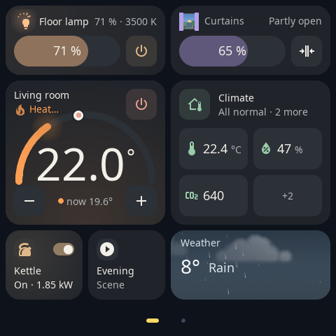

# Getting started

[Русская версия](ru/getting-started.md) · [← Back to README](../README.md)

From a freshly installed S1E Panel to your first working card. If S1E Panel is not installed yet, start with the [installation guide](installation.md).

## Finding your way around the panel

| Gesture | What it does |
| --- | --- |
| Swipe left / right | Next or previous page |
| Pull down from the top edge | Quick menu: **Home**, **Add**, **Settings**, **Screen off** and the brightness slider |
| Tap a card | Use it: switch, open, run. Some cards open a larger control on tap |
| Hold a card for 3 seconds | Edit mode: move, resize or remove cards right on the panel |
| Hold the screensaver for 3 seconds | Choose another screensaver |

A new installation starts in Russian. To switch to English: pull down from the top edge → **Настройки** → **Language (Язык)** → **English**.

## 1. Connect the panel to Wi-Fi

Skip this if you gave `--wifi-ssid` to the installer.

1. Pull down from the top edge and tap **Settings**.
2. Open **Wi-Fi**, type the network name (SSID) and the password with the on-screen keyboard and tap **Connect**.
3. When the panel is connected, **Settings → Wi-Fi** shows its state and address. Most routers can also reserve a fixed address for the panel — it makes the editor's address easier to remember.

The panel needs a WPA/WPA2 network with a password of 8–63 characters. It must be reachable from Home Assistant and from the computer or phone you will use for the editor.

## 2. Connect Home Assistant

S1E Panel gets your devices and their states from Home Assistant through the **S1E Panel integration**. No Home Assistant address, token or password is typed anywhere.

1. In Home Assistant open **HACS → ⋮ → Custom repositories**, add `https://github.com/alexshemr/ha-s1e-panel` with the category **Integration**.
2. Install **S1E Panel** in HACS and restart Home Assistant.
3. Open **Settings → Devices & services**. The panel is discovered on your network: next to **S1E Panel** click **Add** and confirm.
4. On the panel, a request appears: tap **Allow: Home Assistant**.

The panel is now online: it shows the time from Home Assistant, and its devices appear in Home Assistant (screen, relays, screensaver, diagnostics).

> [!TIP]
> **Not discovered?** Discovery uses mDNS on the local network. If Home Assistant and the panel are in different VLANs or mDNS is blocked, add the integration manually: **Settings → Devices & services → Add integration → S1E Panel**, enter `https://<panel-ip>:8443`, then on the panel open **Settings → Pair a device** and confirm. See [Troubleshooting](troubleshooting.md#home-assistant-does-not-find-the-panel).

Requirements: Home Assistant **2026.10.1** or newer. Details of the integration, its entities and actions: [ha-s1e-panel](https://github.com/alexshemr/ha-s1e-panel#readme).

## 3. Open the web editor

The editor runs on the panel itself; use any browser on the same network.

1. Open `https://<panel-ip>:8443` (the address is shown in **Settings → Wi-Fi** and **Settings → Pair a device**).
2. The browser warns that the connection is not private: the panel uses its own self-signed certificate. Continue to the site (in Chrome: **Advanced → Proceed**).
3. The editor asks for a code. On the panel open **Settings → Pair a device**: it shows a six-digit code. Type it into the browser.
4. Confirm the new browser on the panel's screen.

The browser stays paired. You can pair several browsers and phones and revoke them later from the editor.

## 4. Add your first card

**In the editor:**

1. Open **Pages**. The preview in the middle is drawn by the same code as the panel.
2. In the page settings on the right click **Add devices**.
3. Find an entity by name or `entity_id` (filters: spaces, types), tick it and click **Add**. Readings that belong together (temperature, humidity, CO₂…) can be ticked together and added as one card.
4. The card appears on the first free place of the page (or on a new page when the page is full). Click it in the preview to open **Card settings**: choose the card type (**Template**), the **Size**, the colour, the icon and which controls and modes the card shows.
5. Drag the card in the preview to move it.
6. Click **Save**. The editor reports *Changes are live on your panel* — the panel shows the card right away.

**Or on the panel:** pull down from the top edge, tap **Add**, choose a device and how it should look. Hold a card for 3 seconds to move or resize it.

Which card fits which entity: [Supported cards](cards.md).

## 5. Check that it works

- Tap the card on the panel: the device in Home Assistant reacts, and the card follows its real state (for example the curtain moves while the cover is moving).
- Change the device from Home Assistant or a wall switch: the card updates within a moment.
- In Home Assistant, the panel's **Screen** light turns the screen on and off.

If a card shows a dimmed or "unavailable" state, the entity is unavailable in Home Assistant or the panel lost the connection: see [Troubleshooting](troubleshooting.md).

## Next steps

- [Configuration](configuration.md): pages, colours, screensavers, notifications, screen schedule, relays and updates.
- [Automation examples](https://github.com/alexshemr/ha-s1e-panel/blob/main/AUTOMATIONS.md): a doorbell photo on the panel, tomorrow's weather at bedtime, the screen following presence.
