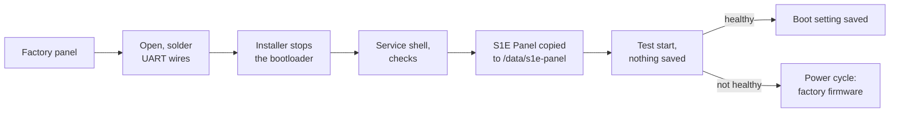

# Installing S1E Panel on the Aqara S1E

[Русская версия](ru/installation.md) · [← Back to README](../README.md)

This guide takes a factory Aqara Magic Switch S1E to a working S1E Panel. The first installation goes through the panel's service console (UART) and is done once; every later update arrives over Wi-Fi.

**Time:** about an hour, most of it opening the panel and soldering. **Difficulty:** you should be comfortable with a soldering iron and a command line.

> [!CAUTION]
> **Read before you start.**
> - S1E Panel is an independent, unofficial project. It is not made, endorsed or supported by Aqara or Lumi United Technology.
> - Opening and modifying the panel may void its warranty.
> - Mistakes can damage the panel or leave it unable to start.
> - The Aqara S1E is a **mains-powered** device. Switch off the circuit breaker and remove the panel from the wall before you open it. Never work on an open panel that is connected to mains.
> - Soldering and work on electronics carry risks of burns, fire and damage: work on a non-flammable surface, protect the board from static electricity and use eye protection.
> - You do everything at your own risk. The authors do not guarantee a successful installation and, to the extent permitted by applicable law, accept no liability for damage resulting from modifying the device.

## How the installation works



- The factory root file system, kernel, partitions and bootloader are **not modified**. S1E Panel lives in its own folder on the panel's existing data volume.
- Only one bootloader setting changes: the boot arguments now mount the data volume and start S1E Panel; if it cannot start, the factory system starts instead. The factory value is kept on the panel as `s1e_factory_bootargs`, and the installer can put it back.
- Nothing is saved until S1E Panel has started once and reported healthy. Until then a power cycle returns the panel to the factory firmware.
- While S1E Panel is installed, the factory Aqara software does not run: the panel is no longer controlled by the Aqara Home app or Aqara's cloud services. It is controlled by Home Assistant instead.

## Stage 1. Preparation

### Is your panel supported?

S1E Panel supports one model: **Aqara Magic Switch S1E, NPD1121WSK01** — the 480 × 480 touch panel with three relays. Check the model number on the packaging; inside, the main board carries the same marking (visible on [niceboygithub's photo](https://github.com/niceboygithub/AqaraSmartSwitchS1E/blob/master/images/s1e_uart.png)).

The installer checks the rest before it writes anything: the flash layout, the stock 4.9.84 kernel, the display and Wi-Fi drivers and the free space on the data volume. If anything differs, it stops and changes nothing. You can run this check alone first (`--check`, see Stage 4).

> [!NOTE]
> S1E Panel has been developed and tested on panels with the Bouffalo Lab Wi-Fi module. A panel with the SSW102B Wi-Fi module is refused by the installer because it has not been tested.

### What you need

| | |
| --- | --- |
| **USB-UART adapter** | 3.3 V logic level (for example a CP2102 module; S1E Panel was developed with one). Only GND, TX and RX are connected — not the adapter's 3.3 V or 5 V pin. |
| **Wires** | Three thin wires (e.g. 30 AWG) with Dupont connectors for the adapter |
| **Soldering** | Fine-tipped soldering iron, thin solder, flux. Soldering to the pads is the reliable option recommended by niceboygithub; the connection must hold for the whole installation |
| **Tools** | Thin plastic pry tool or guitar pick, small screwdriver, tweezers, multimeter (recommended), magnifier |
| **Computer** | Windows, macOS or Linux with [Python 3.9+](https://www.python.org/downloads/) and `pyserial` |
| **Files** | From the [latest release](https://github.com/alexshemr/s1e-panel/releases/latest): `s1e-panel-first-install.tar.gz` and `SHA256SUMS.txt`; and the installer [`installer/s1e_install.py`](../installer/s1e_install.py) |
| **Network** | Your Wi-Fi name and password (WPA2, 8–63 characters) and a Home Assistant 2026.10.1+ with HACS |

## Stage 2. Access to the panel's console

Getting into the S1E's system was worked out by the community before S1E Panel existed, and this project builds on that work:

- **[oopuuu/AqaraS1E-Custom-GUI](https://github.com/oopuuu/AqaraS1E-Custom-GUI)** by **oopuuu** — its guide describes the UART wiring, stopping the U-Boot bootloader and booting the stock kernel into a root shell by replacing `init=/linuxrc` with `init=/bin/sh`.
- **[niceboygithub/AqaraSmartSwitchS1E](https://github.com/niceboygithub/AqaraSmartSwitchS1E)** by **niceboygithub** — its notes describe opening the panel, the UART pads with a pinout photo, stopping U-Boot (also on panels made after July 2023) and the same `init=/bin/sh` boot.

S1E Panel's installer uses exactly this console access.

Please read their guides — [oopuuu's README](https://github.com/oopuuu/AqaraS1E-Custom-GUI#readme) and [niceboygithub's "Enable Telnet" notes](https://github.com/niceboygithub/AqaraSmartSwitchS1E/blob/master/homeassistant/telnet.md) — before you open the panel. Their photos and instructions are theirs; this guide links to them instead of copying them.

> [!NOTE]
> You only need their **console access** steps (hardware, UART, bootloader). Do **not** remove the root password or flash their modified telnet firmware: S1E Panel does not use telnet, and its installer does the remaining steps for you.

## Stage 3. Connecting to the board

1. **Disconnect mains.** Switch off the circuit breaker for the panel and check with a voltage tester that it is off. Remove the panel from the wall box.
2. **Open the panel** as shown in oopuuu's and niceboygithub's guides. Work slowly with a plastic tool; the display's flex cable must not be pulled.
3. **Find the console pads.** On [niceboygithub's photo](https://github.com/niceboygithub/AqaraSmartSwitchS1E/blob/master/images/s1e_uart.png) they are pads of header **J3**, below TP2/TP11/TP12, marked **Rx**, **Tx** and **GND**. J3 has four pads; only these three are used. Compare with your board before soldering; with a multimeter, GND has continuity to the board's ground.
4. **Solder** a short wire to each of the three pads. Keep the joints small and check that neighbouring pads are not bridged.
5. **Connect the adapter** crosswise:

   | Panel | USB-UART adapter |
   | --- | --- |
   | GND | GND |
   | Tx | RX |
   | Rx | TX |

   Leave the adapter's 3.3 V / 5 V pin unconnected. Settings, if you check with a terminal program: **115200 baud, 8N1**, no flow control.
6. **Power.** The console works only while the panel is powered, so plan how it will be powered with the wires attached — **never with an open panel on mains**. niceboygithub's photo also marks **pin 1 = 5 V** and **pin 2 = GND** of the board's power header; supplying the board from a separate 5 V source there keeps mains out of your setup. If you are not sure how to do this safely, stop here and ask someone experienced.
7. **Plug the adapter into the computer** and note its port: `COM3`, `COM5`… on Windows (Device Manager → Ports), `/dev/ttyUSB0` on Linux, `/dev/tty.usbserial-…` on macOS.

> [!TIP]
> You can check the wiring with any serial terminal (PuTTY, minicom, screen) at 115200 baud before running the installer: on power-up you should see bootloader messages starting with `U-Boot`. Close the terminal before you start the installer — only one program can use the port.

## Stage 4. Installing S1E Panel

### 4.1 Prepare the computer

Put the downloaded files into one folder, open a terminal there and install `pyserial`:

```bash
python -m pip install pyserial
```

### 4.2 Check the panel (optional, writes nothing)

```bash
python s1e_install.py --port COM5 --check
```

Replace `COM5` with your port. When it says *Waiting for the bootloader*, power the panel on. The installer stops the bootloader, boots the stock kernel once into a service shell, checks the panel and reboots it into the factory firmware. Nothing is written.

### 4.3 Install

```bash
python s1e_install.py --port COM5 --bundle s1e-panel-first-install.tar.gz --sums SHA256SUMS.txt --wifi-ssid "Your Wi-Fi"
```

`--wifi-ssid` is optional: the installer asks for the password (it is not shown and not written to the log) and the panel joins the network on its first start. Without it, connect the panel to Wi-Fi on its screen afterwards.

Power the panel on when asked. The installer then works through six steps:

| Step | What happens |
| --- | --- |
| 1/6 | Stops the bootloader and saves the factory boot arguments to `s1e-install-logs/<time>/boot-environment.json` on your computer |
| 2/6 | Boots the stock kernel once into a service shell (temporary; nothing saved) |
| 3/6 | Checks the kernel, drivers, flash layout and free space on the data volume |
| 4/6 | Sends the bundle over the console, checks its SHA-256, unpacks it into `/data/s1e-panel` and verifies the signed application inside |
| 5/6 | Restarts the panel with the new boot arguments — still not saved — and waits until S1E Panel reports that its interface is running |
| 6/6 | Saves the boot arguments (keeping the factory value as `s1e_factory_bootargs`) and starts S1E Panel |

Sending the bundle takes a few minutes; the installer raises the console speed when the adapter allows it and shows the progress. Keep the wires steady until it prints **Done**.

> [!NOTE]
> **Panels that do not stop at the bootloader.** On some S1E panels made after July 2023, pressing Enter (which is what the installer does) does not stop U-Boot. If the installer keeps saying *The bootloader was not stopped in time*, see niceboygithub's notes on stopping U-Boot on those units. Their method shorts pins of the flash chip during boot and **can brick the panel**; use it only if you understand the circuit.

### 4.4 Successful installation

The installer ends with:

```text
Done. S1E Panel now starts by itself.
Panel address: 192.168.1.50  ->  editor: https://192.168.1.50:8443
```

The panel shows a short start-up animation and then an empty page. A new installation starts in Russian (*Нет карточек — Нажмите +, чтобы добавить устройства*); to switch to English, pull down from the top edge, tap **Настройки** (the gear) and choose **Language (Язык) → English**. You can now remove the wires (or leave them, insulated, if you expect to need the console again) and reassemble the panel. Keep the pads accessible if possible: the console is the recovery path if the panel ever loses both its network and its system files.

Continue with **[Getting started](getting-started.md)**.

### 4.5 If something goes wrong

| Message | What to do |
| --- | --- |
| *No bootloader on the console* | Check TX↔RX crossing, GND and the port name. Power-cycle the panel while the installer waits. |
| *The bootloader was not stopped in time* | Power the panel off and on again; it retries. For panels made after July 2023 see the note above. |
| *Unexpected flash layout* / *Unexpected kernel* / *Stock drivers missing* | Your panel is not the supported model or runs a system S1E Panel has not been tested with. Nothing was changed. |
| *SHA-256 does not match* | Download the bundle and `SHA256SUMS.txt` again from the same release. |
| *The bundle arrived damaged* | A noisy connection. Shorten the wires, check the joints and run the installer again. |
| *… already exists from an earlier, unfinished installation* | A previous run stopped half-way. Run again with `--replace-incomplete`. |
| *S1E Panel did not report a healthy start* | Nothing was saved: power-cycle the panel and it starts the factory firmware. Open an issue with the folder `s1e-install-logs/<time>`. |
| *S1E Panel already starts on this panel* | It is installed. Update it from **Settings → Panel update** instead. |

Every run keeps a full console log in `s1e-install-logs/<time>/console.log` (without your Wi-Fi password). Attach it when you [open an issue](https://github.com/alexshemr/s1e-panel/issues).

### Going back to the factory firmware

```bash
python s1e_install.py --port COM5 --restore-factory-boot
```

This puts the saved factory boot arguments back, so the panel starts the factory firmware again. S1E Panel's files stay in `/data/s1e-panel` on the data volume and are not used.

## After the installation

- **Updates** arrive over Wi-Fi: **Settings → Panel update → Check for updates → Download → Install** on the panel or in the web editor. Each update is verified, test-started and rolled back automatically if it fails. The console is not needed again.
- **[Getting started](getting-started.md)** — Wi-Fi, Home Assistant, the web editor and your first card.
- **[Troubleshooting](troubleshooting.md)** — what to do when something does not work.
