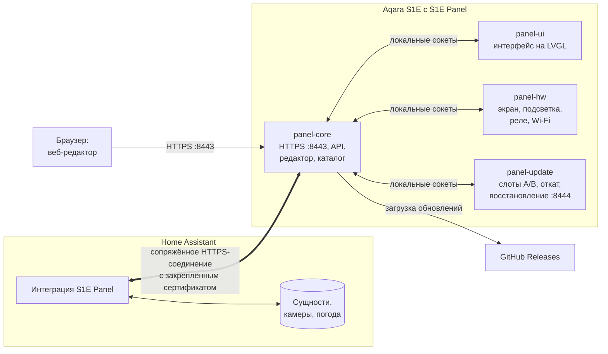

# Как устроена S1E Panel

[English version](../architecture.md) · [← К README](../../README.ru.md)

Коротко о том, что работает на панели, как она общается с Home Assistant и где хранятся ваши настройки.

## На панели

S1E Panel — приложение для штатной Linux-системы панели. Оно сохраняет заводское ядро и драйверы и заменяет только пользовательский интерфейс и его службы.

| Процесс | Задача |
| --- | --- |
| **panel-ui** | Рисует интерфейс на LVGL в разрешении 480 × 480 и обрабатывает жесты. Доступа к сети у него нет. |
| **panel-core** | Центр: конфигурация, связь с Home Assistant, каталог сущностей, команды, уведомления, сопряжение, HTTPS-сервер редактора и [локального API](api.md), загрузка обновлений. |
| **panel-hw** | Оборудование: экран (через заводской драйвер дисплея), подсветка, реле, настройки Wi-Fi. |
| **panel-update** | Обновлятор, отдельный от приложения: проверяет подписанные пакеты, переключает слоты приложения, откатывает неудачное обновление и держит небольшую службу восстановления на порту 8444, даже если приложение не запускается. |

Процессы общаются через локальные сокеты. Графика отделена от сети: сбой одной части не роняет остальные, а обновлятор переживает поломку приложения.

**Заводское ПО Aqara не запускается**, пока работает S1E Panel: панелью больше не управляют приложение Aqara Home и облачные сервисы Aqara. Её реле, экран и датчики используют S1E Panel и Home Assistant.

## Запуск

1. Загрузчик на мгновение показывает картинку запуска (после установки — логотип S1E Panel) и запускает заводское ядро с параметрами S1E Panel: они подключают раздел данных и запускают стартовый сценарий S1E Panel. Если сценарий не может выполниться, запускается заводская система.
2. Стартовый сценарий загружает заводские драйверы экрана и Wi-Fi, подключается к Wi-Fi и запускает обновлятор.
3. Обновлятор запускает приложение из активного слота (A или B).

## Связь с Home Assistant

- **Обнаружение:** панель объявляет себя в локальной сети через mDNS (`_s1e-panel._tcp`) со своим идентификатором и отпечатком сертификата. Интеграция находит её там или по введённому адресу.
- **Сопряжение:** интеграция просит подключения, а вы подтверждаете его на экране панели. Home Assistant хранит ключ, панель — только его хеш. Отпечаток сертификата панели закрепляется при первом контакте; изменённый сертификат молча не принимается.
- **Никакого токена на панели:** интеграция сама открывает зашифрованное соединение с панелью и передаёт ей то, что нужно карточкам. Панель никогда не получает токен Home Assistant и не входит в Home Assistant.
- **Сущности и состояния:** интеграция передаёт каталог сущностей (имена, пространства, устройства, возможности), а затем изменения состояний по мере их появления. Так же панель получает время, часовой пояс и прогнозы погоды.
- **Команды:** касание карточки превращается в команду (например, `light.turn_on` с яркостью), которая уходит в Home Assistant по тому же соединению. Карточка сразу показывает новое состояние и подтверждает его, когда Home Assistant сообщит об изменении; если устройство не отреагировало, карточка возвращается к настоящему состоянию. Принимаются только сущности с карточек панели и только действия, которые используют их карточки.
- **Изображения:** кадры камер, картинку модели 3D-принтера и фотографии в сообщениях снимает Home Assistant: он вписывает снимок в экран и отправляет JPEG. Читать можно только камеры с карточек панели или переданные в `show_message`.

## Веб-редактор

Редактор — веб-приложение, которое отдаёт сама панель по адресу `https://<ip-панели>:8443`. Его предпросмотр выполняет **тот же код интерфейса на LVGL, скомпилированный в WebAssembly**, поэтому предпросмотр и экран совпадают попиксельно. При сохранении отправляется вся конфигурация с номером ревизии: если кто-то успел её изменить (на панели или в другом браузере), редактор сообщит об этом, а не затрёт чужие правки.

## Где хранятся настройки

Всё лежит в одной папке на существующем разделе данных панели, `/data/s1e-panel`:

| | |
| --- | --- |
| `releases/A`, `releases/B` | Два слота приложения: текущая версия и предыдущая или следующая |
| `data/` | Ваша конфигурация (страницы, карточки, заставки, экран, реле), сопряжённые клиенты, HTTPS-сертификат, загруженные фото, настройки Wi-Fi |
| `system/` | Обновлятор, доверенный открытый ключ обновлений и стартовые сценарии; обновление приложения их изменить не может |

Изменения конфигурации записываются атомарно, поэтому пропадание питания не оставит полузаписанный файл. Перед пробой новой версии обновлятор делает снимок `data/`; если новая версия не запустилась, назад возвращаются и приложение, и данные.

## Уведомления и погода

- **Уведомления** приходят из Home Assistant (`s1e_panel.show_message`) или через локальный API. Сообщение с высоким приоритетом прерывает то, что на экране; обычное ждёт, пока панель простаивает. Сообщение может нести элемент прогноза погоды или фото.
- **Погода** берётся из сущности `weather` в Home Assistant. Погодные сцены панель рисует сама — своя сцена для каждого состояния погоды Home Assistant, днём и ночью, с частицами дождя, снега, тумана и молний — на карточке погоды, заставке «Живая погода» и в погодных сообщениях. К погодным сервисам панель не обращается.

## Сеть и разрешения

| Направление | Что | Зачем |
| --- | --- | --- |
| Входящее: TCP 8443 (HTTPS) | Веб-редактор, локальный API, соединение с Home Assistant | Только сопряжённые клиенты (кроме открытых сведений и сопряжения) |
| Входящее: TCP 8444 (HTTPS) | Служба восстановления обновлятора | Только сопряжённые клиенты |
| mDNS | Объявление `_s1e-panel._tcp` | Обнаружение интеграцией |
| Исходящее: HTTPS к GitHub | `api.github.com`, `github.com` и файловое хранилище GitHub | Проверка и загрузка обновлений, только когда вы об этом просите |

Для повседневной работы панели не нужны ни облачные сервисы, ни интернет; интернет используется только для обновлений с GitHub. Home Assistant должен иметь доступ к панели по порту 8443.

## Нужна ли дополнительная интеграция в Home Assistant?

Да: **интеграция S1E Panel** (HACS: [alexshemr/ha-s1e-panel](https://github.com/alexshemr/ha-s1e-panel)). Именно она передаёт панели ваши сущности без токена и даёт Home Assistant экран, реле, заставку и уведомления панели. Другие дополнения, MQTT-брокер или YAML не нужны.
