# Карточки

[English version](../cards.md) · [← К README](../../README.ru.md) · [**Интерактивная галерея**](https://alexshemr.github.io/s1e-panel/gallery.html?lang=ru)

Все типы карточек текущего выпуска: какие сущности Home Assistant они принимают, чем управляют и в каких размерах бывают. Все изображения вырезаны 1:1 из кадров, которые отрисовал рендерер самой прошивки, поэтому карточка здесь ровно такого размера, как на экране 480 × 480.

**Размеры** указаны в ячейках сетки: экран — это сетка 8 × 8, значит `4×4` — четверть экрана, а `8×8` — вся страница. Каждая карточка подстраивает раскладку под размер: чем больше карточка, тем больше на ней управления.

**Общие настройки** любой карточки (редактор → карточка → **Настроить карточку**): название, иконка (любая из 7 000+ Material Design Icons), цвет акцента (для карточки или для типа устройств), а у карточек с несколькими элементами — какие элементы и режимы устройства показывать и в каком порядке.

| Карточка | Сущности Home Assistant | Размеры |
| --- | --- | --- |
| [Свет](#свет) | `light` | 11: 2×2 … 8×8 |
| [Шторы](#шторы-и-рулонная-штора) | `cover` | 11 |
| [Рулонная штора](#шторы-и-рулонная-штора) | `cover` | 11 |
| [Термостат](#термостат) | `climate` | 11 |
| [Кондиционер](#кондиционер) | `climate` | 9: 2×2 … 8×6 |
| [Увлажнитель](#увлажнитель) | `humidifier` | 11 |
| [Вентилятор](#вентилятор) | `fan` | 11 |
| [Бризер](#бризер) | `fan` + датчики воздуха | 11 |
| [Микроклимат](#микроклимат) | `sensor` (несколько) | 11 |
| [Выключатель](#выключатель-реле-и-действие) | `switch`, `input_boolean` | 2×2, 2×4, 4×2 |
| [Реле](#выключатель-реле-и-действие) | собственные реле панели | 2×2, 2×4, 4×2 |
| [Действие](#выключатель-реле-и-действие) | `scene`, `script`, `button`, `input_button` | 2×2, 2×4, 4×2 |
| [Время](#время-и-дата-и-время) | `input_datetime` | 2×4, 4×2, 4×4, 8×2 |
| [Число](#число-выбор-и-текст) | `number`, `input_number` | 2×2, 2×4, 4×2, 4×4, 8×2 |
| [Выбор](#число-выбор-и-текст) | `select`, `input_select` | 2×2, 2×4, 4×2, 4×4, 8×2 |
| [Текст](#число-выбор-и-текст) | `text`, `input_text` | 4×2, 4×4, 8×2, 8×4 |
| [Погода](#погода) | `weather` | 11 |
| [3D-принтер](#3d-принтер) | датчики принтера Bambu Lab | 9 |
| [Показание, датчик](#показание-показания-и-датчик) | `sensor`, `binary_sensor` | 10 |

«11» — все размеры: 2×2, 2×4, 2×6, 2×8, 4×2, 4×4, 4×6, 8×2, 8×4, 8×6, 8×8. «10» — то же без 8×4.

## Интерактивные демо

[Интерактивная галерея](https://alexshemr.github.io/s1e-panel/gallery.html?lang=ru) и [конструктор панели](https://alexshemr.github.io/s1e-panel/demo/stands/home-stand.html?lang=ru&mode=play) позволяют пользоваться каждой карточкой в браузере с имитацией устройств: ни Home Assistant, ни панель не нужны.

Что это такое, честно:
- **Демо карточек** — интерактивные эталоны («стенды»), по которым сделана и проверяется каждая карточка прошивки: те же правила раскладки для каждого размера, те же цвета, тексты и поведение. Прошивка рисует их нативно на LVGL; часть анимаций на панели упрощена (например, свечение — это подсветка, а не «дыхание»).
- **Демо веб-редактора** — настоящий редактор панели с **рендерером прошивки, скомпилированным в WebAssembly**: предпросмотр там попиксельно совпадает с тем, что рисует панель. Предпросмотр служит для расстановки карточек: касание выбирает карточку, а не управляет устройством.
- Устройства имитируются: изменения остаются в вашем браузере.

---

## Свет

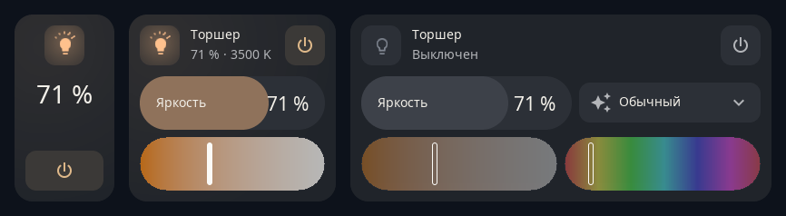

Яркость, цветовая температура, цвет и эффекты сущности `light`, а также быстрые пресеты яркости. Карточка показывает только то, что умеет лампа; любой из этих блоков можно скрыть. Иконка лампы светится текущим цветом света.

- **Управление:** включение, ползунок яркости, цветовая температура, цвет, список эффектов (как «режимы»), быстрые пресеты.
- **Состояния:** включён (свечение цветом лампы), выключен, недоступен; дневной и ночной варианты.
- **Попробовать:** [демо света](https://alexshemr.github.io/s1e-panel/demo/stands/light-stand.html)

## Шторы и рулонная штора

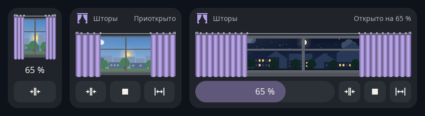
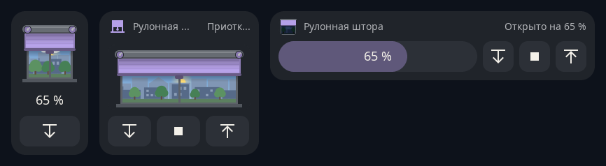

Два вида для сущности `cover`: шторы, которые разъезжаются в стороны, или рулонная штора, которая опускается из короба. За ними окно с городом и небом, которое следует за настоящими солнцем и луной.

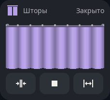

- **Управление:** ползунок положения, открыть, стоп, закрыть. Карточка повторяет настоящее движение привода; если в редакторе указано время полного открытия и закрытия, анимация совпадает с вашим мотором.
- **Блоки, которые можно скрыть:** положение, стоп, сцена с окном, кнопки.
- **Состояния:** открыто, приоткрыто, закрыто, открывается / закрывается, недоступно; днём и ночью.
- **Попробовать:** [шторы](https://alexshemr.github.io/s1e-panel/demo/stands/cover-stand.html) · [рулонная штора](https://alexshemr.github.io/s1e-panel/demo/stands/roller-stand.html)

 

## Термостат

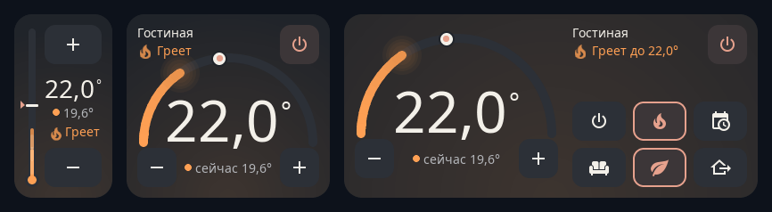

Целевая температура сущности `climate` кнопками − и + (удержание повторяет). Сразу видно, идёт ли нагрев: пламя и тёплое свечение.

- **Раскладка:** градусник на узких карточках, полукруглая шкала начиная с 4×4, режимы и пресеты на больших карточках.
- **Управление:** −/+, включение, режимы и пресеты из сущности (вы выбираете, какие показывать, в каком порядке, с какой иконкой и подписью).
- **Состояния:** греет, не греет, выключен, недоступен.
- **Попробовать:** [демо термостата](https://alexshemr.github.io/s1e-panel/demo/stands/thermostat-stand.html)

## Кондиционер

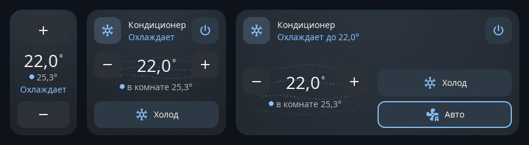

Сущность `climate` в Home Assistant, которая охлаждает: холод, тепло, осушение, вентиляция и авто. Карточка окрашивается в цвет режима (холод — голубой, тепло — оранжевый, осушение — бирюзовый), а пока кондиционер работает, из решётки идёт воздух — быстрее на высокой скорости, с покачиванием, когда включено качание.

- **Раскладка:** цель между − и + над потоком воздуха; на 8×4 крупная цель слева, ряды справа.
- **Управление:** −/+ (удержание повторяет), включение, режимы рядом иконок, скорость вентилятора (`fan_modes`) и качание (`swing_modes`), если они есть у сущности. Ряд, который не помещается, становится одной кнопкой, перебирающей варианты.
- **Состояния:** охлаждает, греет, осушает, проветривает, держит температуру, выключен, нет связи.
- **Попробовать:** [демо кондиционера](https://alexshemr.github.io/s1e-panel/demo/stands/ac-stand.html)

## Увлажнитель

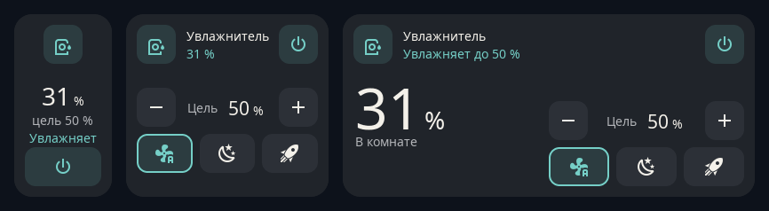

Целевая влажность сущности `humidifier` шагом 5 %, а пока увлажнитель работает — поднимается пар.

- **Управление:** −/+, включение, режимы из сущности.
- **Бак с водой (необязательно):** привяжите датчик уровня воды или `binary_sensor` «нет воды», чтобы показать бак.
- **Состояния:** увлажняет, ждёт, выключен, бак пуст, недоступен.
- **Попробовать:** [демо увлажнителя](https://alexshemr.github.io/s1e-panel/demo/stands/humidifier-stand.html)

## Вентилятор

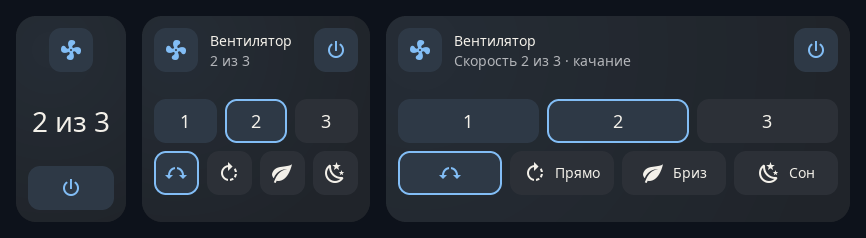

Сущность `fan`: скорость ступенями (3–6 скоростей) или плавно ползунком, качание, направление и пресеты. Крыльчатка крутится с настоящей скоростью.

- **Попробовать:** [демо вентилятора](https://alexshemr.github.io/s1e-panel/demo/stands/fan-stand.html)

## Бризер

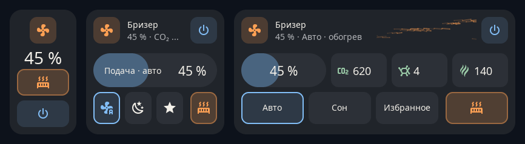

Приточная установка (сущность `fan`) со всем, что к ней относится, на одной карточке: подача воздуха, пресеты режимов (например, «Авто», «Сон», «Избранное»), обогрев и до трёх датчиков воздуха (CO₂, PM2.5, TVOC) с цветом уровня.

- **Привязки:** вентилятор, необязательный выключатель обогрева, до трёх датчиков.
- **Попробовать:** [демо бризера](https://alexshemr.github.io/s1e-panel/demo/stands/breezer-stand.html)

## Микроклимат

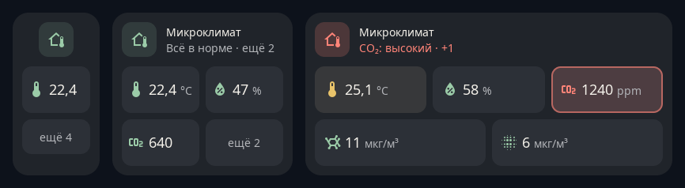

Показатели комнаты на одной карточке: температура, влажность, CO₂, PM2.5, PM1 и другие (до шести датчиков). Цвет показывает, в норме ли каждое значение; значения вне нормы выделяются, а заголовок подводит итог (например, *Всё в норме*).

- **Раскладка:** компактные плитки, плитки со шкалой или подробные плитки с диапазоном нормы — в зависимости от размера. Нажмите на маленькую плитку, чтобы увидеть подробности.
- **Попробовать:** [демо микроклимата](https://alexshemr.github.io/s1e-panel/demo/stands/climate-stand.html)

## Выключатель, реле и действие

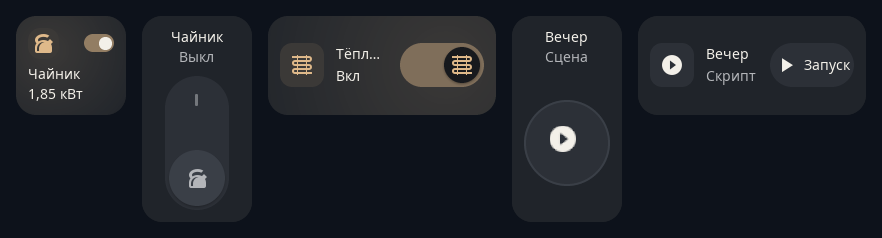

Карточки в одно касание: кнопка — вся карточка.

- **Выключатель** — `switch` или `input_boolean`: маленький переключатель на 2×2, настенная клавиша на 2×4, клавиша на боку на 4×2. Может показывать мощность рядом со «Вкл», например *Вкл · 1,85 кВт*.
- **Реле** — одно из трёх встроенных реле панели (работает и без Home Assistant).
- **Действие** — `scene`, `script`, `button` или `input_button`: круглая кнопка или плашка *Запуск*; пока скрипт выполняется, бежит обводка, в конце появляется галочка.
- **Попробовать:** [демо выключателя, реле и действия](https://alexshemr.github.io/s1e-panel/demo/stands/button-stand.html)

## Время и дата и время

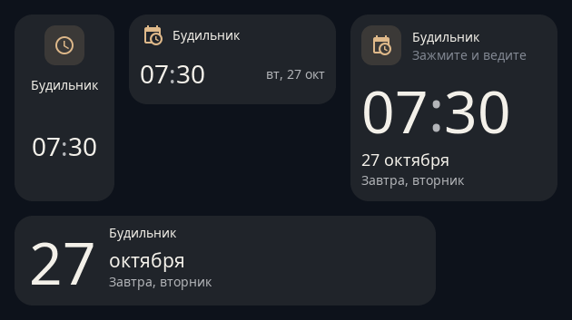

Для помощников `input_datetime`: будильника, напоминания, срока.

- **Время:** варианты с часами и датой для 2×4, 4×2, 4×4 и 8×2. Удерживайте часы, минуты или дату, чтобы открыть барабаны; **Готово** сохраняет новое значение в Home Assistant, **Отмена** (или 10 секунд без касаний) закрывает их.
- **Попробовать:** [демо времени](https://alexshemr.github.io/s1e-panel/demo/stands/time-stand.html)

## Число, выбор и текст

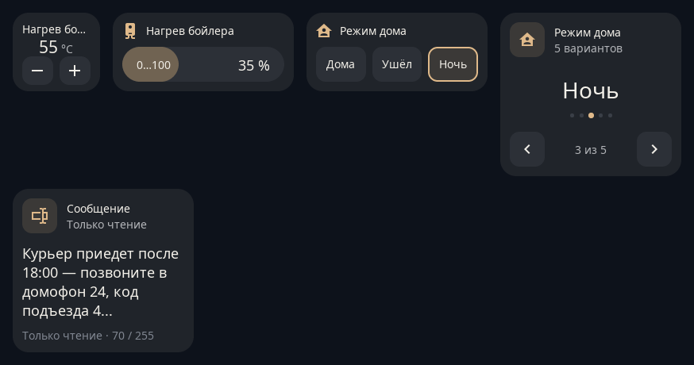

Вспомогательные сущности Home Assistant и настройки устройств:

- **Число** (`number`, `input_number`): кнопки − / + или ползунок, в зависимости от режима сущности.
- **Выбор** (`select`, `input_select`): кнопки, если вариантов немного, стрелки с точками, если много.
- **Текст** (`text`, `input_text`): показывает текст и сколько времени назад он изменился — доска объявлений для семьи.
- **Попробовать:** [демо числа, выбора и текста](https://alexshemr.github.io/s1e-panel/demo/stands/inputs-stand.html)

## Погода

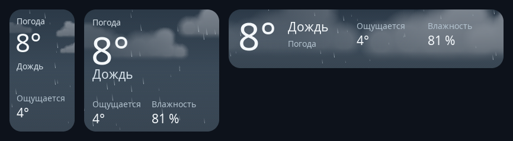

Сущность `weather` на анимированном небе: у каждого состояния погоды своя сцена, днём и ночью, а на больших карточках — температура, состояние, ощущаемая температура и влажность. Те же сцены работают на погодной заставке и в погодных уведомлениях.

- **Попробовать:** [демо погоды](https://alexshemr.github.io/s1e-panel/demo/stands/weather-stand.html)

## 3D-принтер

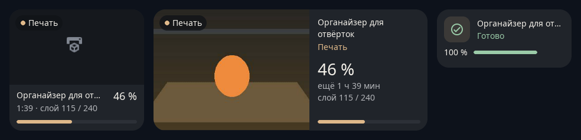

Текущая печать принтера Bambu Lab, подключённого к Home Assistant через [ha-bambulab](https://github.com/greghesp/ha-bambulab): статус, название модели, прогресс и оставшееся время; на больших карточках — слой, вес, температуры сопла и стола, **Пауза** и **Стоп**, камера принтера и картинка модели из слайсера.

- **Привязка:** выберите датчик `print_status` принтера; остальные датчики находятся по префиксу принтера.
- **Камера:** новый кадр каждые 2 секунды на карточке; нажмите, чтобы открыть на весь экран (кадр каждую секунду). Нужна интеграция S1E Panel 0.5.0 или новее.
- **Состояния:** подготовка, печать, пауза, готово, ошибка, ожидание, выключен.
- **Попробовать:** [демо 3D-принтера](https://alexshemr.github.io/s1e-panel/demo/stands/printer-stand.html)

## Показание, показания и датчик

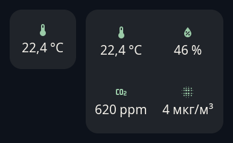

Простые плитки значений для сущностей `sensor` и `binary_sensor`: **Показание** показывает значение, **Датчик** — состояние словом (*Открыта*, *Закрыта*, *Протечка*, *Движение*…). Иконка берётся из сущности, из настроек карточки или, если их нет, по типу показания. Для показателей комнаты с нормами и цветами используйте карточку [Микроклимат](#микроклимат).

---

## Заставки

Это не карточки, а часть экрана: см. [Настройка → Заставки](configuration.md#заставки).

| Только время | Пульс дома | Живая погода | Любимый момент | Луна |
| --- | --- | --- | --- | --- |
| 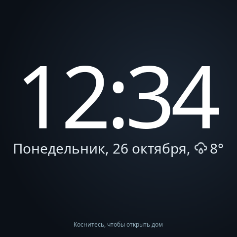 | 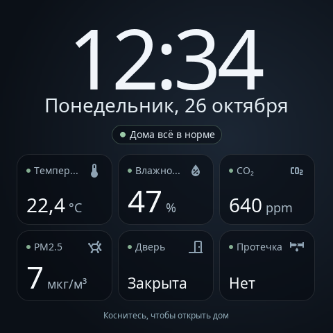 | 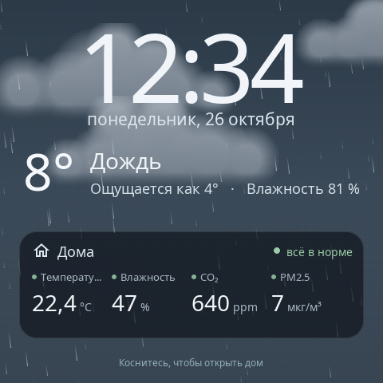 | 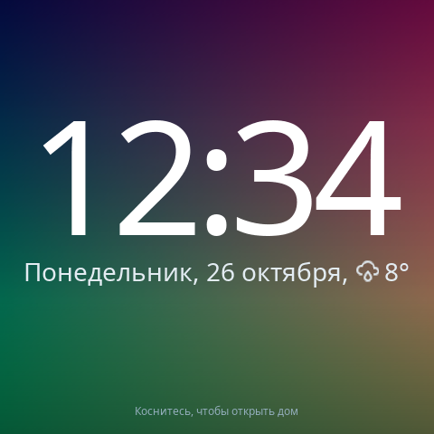 | 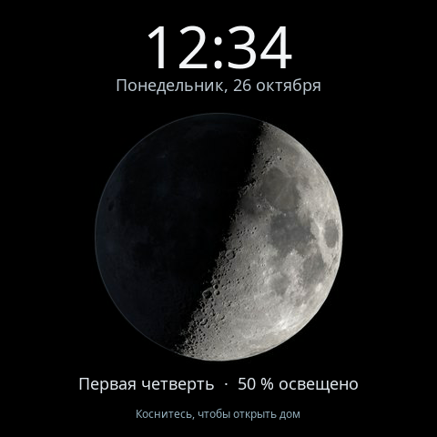 |

[Попробовать заставки](https://alexshemr.github.io/s1e-panel/demo/stands/saver-stand.html)
