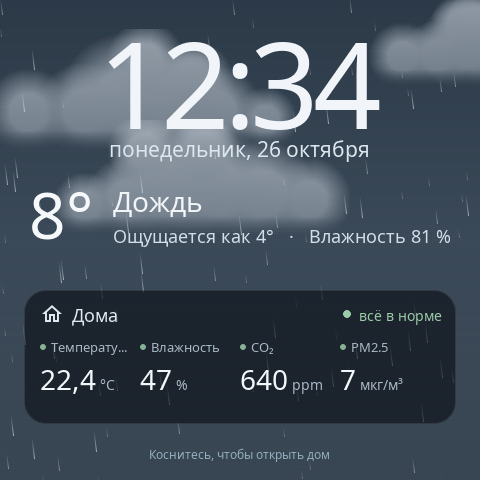
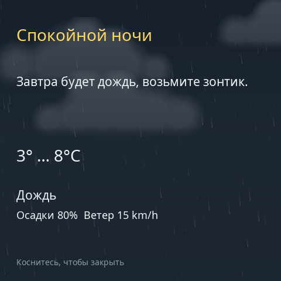
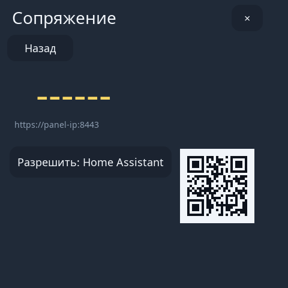

# Настройка

[English version](../configuration.md) · [← К README](../../README.ru.md)

Всё описанное здесь настраивается в веб-редакторе (`https://<ip-панели>:8443`), а большая часть — и на самой панели (потяните вниз от верхнего края → **Настройки**). Изменения в редакторе применяются кнопкой **Сохранить**; правки можно откатить кнопкой **Отменить**.

## Страницы и раскладка

- **Страницы:** вкладки над предпросмотром. **+** добавляет страницу; настройки страницы справа позволяют переименовать или удалить её. На панели страницы листаются свайпом влево и вправо.
- **Сетка:** каждая страница — 8 × 8 ячеек. Карточки занимают от 2×2 до 8×8 ячеек (см. [размеры карточек](cards.md)). Перетащите карточку в предпросмотре, чтобы переставить её; **Размер** выбирается в **Настроить карточку**; карточка, которая не помещается, не ставится поверх других.
- **Действия с карточкой:** копия, удаление, перенос на другую страницу.
- **На панели:** удерживайте карточку 3 секунды, чтобы переместить, изменить размер или удалить её; **Добавить** в быстром меню добавляет устройство.
- **Резервная копия:** **Настройки → Экспорт** сохраняет всю конфигурацию (страницы, карточки, заставки, экран, реле) в файл `s1e-panel.json`; **Импорт** загружает её обратно. Фотографии и секреты в файл не входят.

## Внешний вид

- **Язык:** русский или английский, для панели и редактора (**Настройки → Language (Язык)** на панели или в настройках редактора).
- **Цвета:** основной цветовой акцент, цвет для каждого типа устройств (**Назначение по типам**) и при желании цвет отдельной карточки (**Акцент карточки**).
- **Иконки:** любая иконка Material Design для карточки (**Иконка MDI**), с поиском.
- **Содержимое карточки:** какие элементы управления показывать, какие режимы и пресеты устройства выводить, в каком порядке, с какой иконкой и подписью.
- **Уменьшить движение:** заменяет анимации спокойными статичными вариантами (в том числе анимацию запуска).

## Заставки

Заставка появляется после **тайм-аута бездействия** и исчезает от касания.

| Заставка | Что показывает | Настройки |
| --- | --- | --- |
| **Только время** | Крупные часы и дату с сегодняшней погодой | Источник погоды, фото на фоне |
| **Пульс дома** | Часы и до шести показателей дома в цветах норм (в том числе двери и протечки) с коротким итогом | Датчики и их порядок |
| **Живая погода** | Часы на анимированном небе текущей погоды и плитка «Дома» с четырьмя показателями | Источник погоды, датчики |
| **Любимый момент** | Ваши фотографии слайд-шоу с часами и погодой | Фотографии, интервал смены |
| **Перемешивание** | Выбранные заставки по очереди или случайно | Какие заставки, раз в 1 мин … 3 ч |

- **Фотографии** загружаются в настройках заставки в редакторе (**Загрузить фото**) и хранятся на панели (до 5 МиБ на все).
- **На панели:** удерживайте заставку 3 секунды, чтобы выбрать другую.
- **Из Home Assistant:** сущность выбора **Заставка** из интеграции (`clock`, `sensors`, `weather`, `photo`, `shuffle`) переключает её в автоматизациях — например, «Пульс дома», пока воздух плохой.

 

## Экран

| Настройка | Значение |
| --- | --- |
| **Яркость** | Уровень подсветки; есть и в быстром меню панели |
| **Заставка через, сек** | Сколько секунд без касаний до заставки |
| **Затем погасить, сек** | Необязательно: погасить экран через столько секунд (0 — никогда) |
| **Сон по расписанию** | **Выключать в** / **Включать в**: ночью экран остаётся тёмным |

Home Assistant получает экран как сущность **light** (включение и яркость), а ночной режим — как **binary sensor**, поэтому экран может следовать за присутствием или сценой «спокойной ночи». Выключение экрана или ночной режим из Home Assistant важнее заставки.

## Уведомления

Home Assistant отправляет сообщения на панель действием интеграции **`s1e_panel.show_message`**:

- заголовок, текст, иконка и тип (`info`, `success`, `warning`, `error`);
- **приоритет:** `high` показывается сразу поверх всего; `normal` ждёт, пока панель простаивает;
- сколько сообщение висит на экране и сколько остаётся актуальным;
- **прогноз погоды** — элемент прогноза Home Assistant, показанный на анимированном небе этой погоды;
- **фото** из сущности `camera.*` или `image.*`, при желании обновляемое каждую секунду, пока сообщение на экране (`live`), — например, с камеры у двери.

`s1e_panel.dismiss_notification` и `s1e_panel.clear_notifications` убирают сообщения; на панели сообщение закрывается касанием. В редакторе есть кнопка **Проверить уведомление**. Готовые автоматизации (звонок в дверь, погода на завтра, присутствие): [AUTOMATIONS.md](https://github.com/alexshemr/ha-s1e-panel/blob/main/AUTOMATIONS.md) (на английском). Для скриптов без Home Assistant то же доступно через [локальный API](api.md#уведомления).

 

## Реле

У NPD1121WSK01 три реле — собственные выходы панели.

- **Имена** и **Реле после питания** — состояние после пропадания питания: `last` (как было), `off` или `on`.
- Используйте карточку **Реле** на странице или сущности-**выключатели** реле в Home Assistant.
- Панель сообщает состояние, которое она выставила на выходах; она не измеряет, потребляет ли подключённая нагрузка ток.

## Интеграция Home Assistant

[Интеграция S1E Panel](https://github.com/alexshemr/ha-s1e-panel) передаёт панели ваши сущности, а Home Assistant получает:

| Сущность / действие | Для чего |
| --- | --- |
| Экран (`light`) | Включение и яркость |
| Ночной режим (`binary_sensor`) | Идёт ли сон по расписанию |
| Реле (`switch`) | Три реле |
| Заставка (`select`) | Какая заставка показывается |
| Диагностика | Связь и состояние панели |
| `s1e_panel.show_message`, `dismiss_notification`, `clear_notifications` | Сообщения на экране |

С панели можно управлять только сущностями, которые стоят на её карточках, и только теми действиями, которые используют эти карточки.

## Обновления

- **По Wi-Fi:** на панели **Настройки → Обновление панели → Проверить → Скачать → Установить**, или то же в редакторе. Панель сама скачивает выпуск с GitHub.
- **Из файла:** скачайте `s1e-panel-<версия>.s1e` со страницы [Releases](https://github.com/alexshemr/s1e-panel/releases) и загрузите его в редакторе (**Настройки → Обновление панели**).
- Каждый пакет подписан и проверяется до установки. Новая версия ставится во второй слот приложения и запускается на пробу; если она не запустилась как следует за время проверки, панель сама возвращается к прежней версии и прежним данным.
- Обновление интеграции в HACS не обновляет панель, и наоборот.

## Сопряжение и доступ

- **Настройки → Сопряжение** на панели показывает код для нового браузера, телефона или скрипта; каждого нового клиента нужно подтвердить на экране панели.
- Редактор показывает список сопряжённых клиентов; отзовите те, которыми больше не пользуетесь.
- HTTPS-сертификат у панели свой (самоподписанный). Редактор показывает его отпечаток, чтобы его можно было сверить.

 
