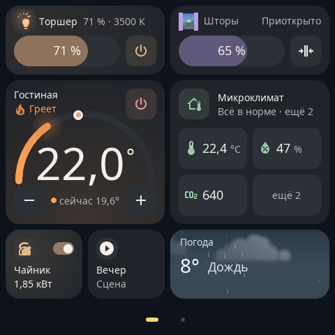

# Первые шаги

[English version](../getting-started.md) · [← К README](../../README.ru.md)

От только что установленной S1E Panel до первой работающей карточки. Если S1E Panel ещё не установлена, начните с [руководства по установке](installation.md).

## Как управлять панелью

| Жест | Что происходит |
| --- | --- |
| Свайп влево / вправо | Следующая или предыдущая страница |
| Потянуть вниз от верхнего края | Быстрое меню: **Домой**, **Добавить**, **Настройки**, **Выключить** и ползунок яркости |
| Нажать на карточку | Использовать её: включить, открыть, запустить. Некоторые карточки по нажатию открывают крупное управление |
| Удерживать карточку 3 секунды | Режим правки: переместить, изменить размер или удалить карточку прямо на панели |
| Удерживать заставку 3 секунды | Выбрать другую заставку |

Интерфейс на английском; русский включается в **Settings → Language (Язык)** → **Русский**.

## 1. Подключите панель к Wi-Fi

Пропустите этот шаг, если передали установщику `--wifi-ssid`.

1. Потяните вниз от верхнего края и нажмите **Настройки**.
2. Откройте **Wi-Fi**, наберите имя сети (SSID) и пароль на экранной клавиатуре и нажмите **Подключить**.
3. Когда панель подключится, в **Настройки → Wi-Fi** появятся её состояние и адрес. В большинстве роутеров можно закрепить за панелью постоянный адрес — так проще запомнить адрес редактора.

Нужна сеть WPA/WPA2 с паролем от 8 до 63 символов. Панель должна быть доступна из Home Assistant и с компьютера или телефона, на котором вы откроете редактор.

## 2. Подключите Home Assistant

Устройства и их состояния S1E Panel получает из Home Assistant через **интеграцию S1E Panel**. Ни адрес Home Assistant, ни токен, ни пароль нигде вводить не нужно.

1. В Home Assistant откройте **HACS → ⋮ → Пользовательские репозитории** и добавьте `https://github.com/alexshemr/ha-s1e-panel` с категорией **Интеграция**.
2. Установите **S1E Panel** в HACS и перезапустите Home Assistant.
3. Откройте **Настройки → Устройства и службы**. Панель будет найдена в сети: рядом с **S1E Panel** нажмите **Добавить** и подтвердите.
4. На панели появится запрос — нажмите **Разрешить: Home Assistant**.

Панель на связи: она показывает время из Home Assistant, а в Home Assistant появляются её устройства (экран, реле, заставка, диагностика).

> [!TIP]
> **Панель не находится?** Поиск работает через mDNS в локальной сети. Если Home Assistant и панель в разных VLAN или mDNS заблокирован, добавьте интеграцию вручную: **Настройки → Устройства и службы → Добавить интеграцию → S1E Panel**, укажите `https://<ip-панели>:8443`, затем на панели откройте **Настройки → Сопряжение** и подтвердите. См. [Решение проблем](troubleshooting.md#home-assistant-не-находит-панель).

Требования: Home Assistant **2026.10.1** или новее. Подробности об интеграции, её сущностях и действиях: [ha-s1e-panel](https://github.com/alexshemr/ha-s1e-panel#readme).

## 3. Откройте веб-редактор

Редактор работает на самой панели; подойдёт любой браузер в той же сети.

1. Откройте `https://<ip-панели>:8443` (адрес есть в **Настройки → Wi-Fi** и **Настройки → Сопряжение**).
2. Браузер предупредит, что подключение не защищено: у панели свой самоподписанный сертификат. Перейдите на сайт (в Chrome: **Дополнительные → Перейти на сайт**).
3. Редактор попросит код. На панели откройте **Настройки → Сопряжение**: там шестизначный код. Введите его в браузере.
4. Подтвердите новый браузер на экране панели.

Браузер остаётся сопряжённым. Можно подключить несколько браузеров и телефонов и позже отозвать доступ в редакторе.

## 4. Добавьте первую карточку

**В редакторе:**

1. Откройте **Страницы**. Предпросмотр в центре рисуется тем же кодом, что и панель.
2. В настройках страницы справа нажмите **Добавить устройства**.
3. Найдите сущность по имени или `entity_id` (фильтры: пространства, типы), отметьте её и нажмите **Добавить**. Связанные показатели (температуру, влажность, CO₂…) можно отметить вместе и добавить одной карточкой.
4. Карточка появится на первом свободном месте страницы (или на новой странице, если эта заполнена). Нажмите на неё в предпросмотре, чтобы открыть **Настроить карточку**: выберите тип карточки (**Шаблон**), **Размер**, цвет, иконку и то, какие элементы управления и режимы она показывает.
5. Перетащите карточку в предпросмотре, чтобы переставить её.
6. Нажмите **Сохранить**. Редактор сообщит *Изменения уже на панели* — карточка сразу появится на экране.

**Или на панели:** потяните вниз от верхнего края, нажмите **Добавить**, выберите устройство и вид карточки. Удерживайте карточку 3 секунды, чтобы переместить её или изменить размер.

Какая карточка подходит какой сущности: [Карточки](cards.md).

## 5. Проверьте работу

- Нажмите на карточку на панели: устройство в Home Assistant отреагирует, а карточка покажет его настоящее состояние (например, штора движется, пока движется привод).
- Измените устройство из Home Assistant или настенным выключателем: карточка обновится через мгновение.
- В Home Assistant сущность **Экран** панели включает и выключает экран.

Если карточка приглушена или показывает «недоступно», сущность недоступна в Home Assistant или панель потеряла связь: см. [Решение проблем](troubleshooting.md).

## Что дальше

- [Настройка](configuration.md): страницы, цвета, заставки, уведомления, расписание экрана, реле и обновления.
- [Примеры автоматизаций](https://github.com/alexshemr/ha-s1e-panel/blob/main/AUTOMATIONS.md) (на английском): снимок с дверной камеры на панели, погода на завтра перед сном, экран, который следует за присутствием.
