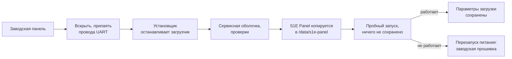

# Установка S1E Panel на Aqara S1E

[English version](../installation.md) · [← К README](../../README.ru.md)

Это руководство проводит заводскую Aqara Magic Switch S1E до работающей S1E Panel. Первая установка идёт через сервисную консоль панели (UART) и делается один раз; все последующие обновления приходят по Wi-Fi.

**Время:** около часа, большая часть — вскрытие и пайка. **Сложность:** нужно уверенно держать паяльник и не бояться командной строки.

> [!CAUTION]
> **Прочитайте перед началом.**
> - S1E Panel — независимый неофициальный проект. Он не создан, не одобрен и не поддерживается Aqara или Lumi United Technology.
> - Вскрытие и модификация панели могут лишить вас гарантии.
> - Ошибки могут повредить панель или сделать её неработоспособной.
> - Aqara S1E питается **от электросети**. Перед вскрытием выключите автомат и снимите панель со стены. Никогда не работайте со вскрытой панелью, подключённой к сети.
> - Пайка и работа с электроникой несут риск ожогов, возгорания и повреждений: работайте на негорючей поверхности, защищайте плату от статического электричества и берегите глаза.
> - Все действия вы выполняете на свой страх и риск. Авторы не гарантируют успешную установку и в пределах, допускаемых применимым законодательством, не несут ответственности за последствия модификации устройства.

## Как устроена установка



- Заводская корневая файловая система, ядро, разделы и загрузчик **не изменяются**. S1E Panel живёт в своей папке на существующем разделе данных панели.
- Меняется одна настройка загрузчика: параметры загрузки теперь подключают раздел данных и запускают S1E Panel, а если она не может запуститься — стартует заводская система. Заводское значение сохраняется на панели как `s1e_factory_bootargs`, и установщик умеет его вернуть.
- Пока S1E Panel не запустится и не сообщит, что работает, ничего не сохраняется. До этого момента перезапуск питания возвращает заводскую прошивку.
- Пока установлена S1E Panel, заводское ПО Aqara не запускается: панелью больше не управляют приложение Aqara Home и облачные сервисы Aqara. Ею управляет Home Assistant.

## Этап 1. Подготовка

### Подходит ли ваша панель

S1E Panel поддерживает одну модель: **Aqara Magic Switch S1E, NPD1121WSK01** — сенсорную панель 480 × 480 с тремя реле. Сверьте номер модели на упаковке; внутри та же маркировка нанесена на основную плату (видно на [фотографии niceboygithub](https://github.com/niceboygithub/AqaraSmartSwitchS1E/blob/master/images/s1e_uart.png)).

Остальное установщик проверяет сам, прежде чем что-либо записать: разметку флеш-памяти, заводское ядро 4.9.84, драйверы экрана и Wi-Fi, свободное место на разделе данных. Если что-то не совпадает, он останавливается и ничего не меняет. Эту проверку можно запустить отдельно (`--check`, см. этап 4).

> [!NOTE]
> S1E Panel разрабатывалась и проверялась на панелях с Wi-Fi-модулем Bouffalo Lab. Панель с модулем SSW102B установщик отклоняет: на ней прошивка не испытывалась.

### Что понадобится

| | |
| --- | --- |
| **USB-UART-адаптер** | С логическими уровнями 3,3 В (например, модуль на CP2102 — с таким разрабатывалась S1E Panel). Подключаются только GND, TX и RX, без выводов 3,3 В и 5 В адаптера. |
| **Провода** | Три тонких провода (например, МГТФ или 30 AWG) с разъёмами Dupont для адаптера |
| **Пайка** | Паяльник с тонким жалом, тонкий припой, флюс. Пайка к площадкам — надёжный способ, который советует niceboygithub; соединение должно держаться всю установку |
| **Инструменты** | Тонкая пластиковая лопатка или медиатор, маленькая отвёртка, пинцет, мультиметр (желательно), лупа |
| **Компьютер** | Windows, macOS или Linux с [Python 3.9+](https://www.python.org/downloads/) и `pyserial` |
| **Файлы** | Из [последнего выпуска](https://github.com/alexshemr/s1e-panel/releases/latest): `s1e-panel-first-install.tar.gz` и `SHA256SUMS.txt`; установщик [`installer/s1e_install.py`](../../installer/s1e_install.py) |
| **Сеть** | Имя и пароль Wi-Fi (WPA2, 8–63 символа) и Home Assistant 2026.10.1+ с HACS |

## Этап 2. Доступ к консоли панели

Путь в систему S1E сообщество нашло ещё до появления S1E Panel, и этот проект опирается на ту работу:

- **[oopuuu/AqaraS1E-Custom-GUI](https://github.com/oopuuu/AqaraS1E-Custom-GUI)**, автор — **oopuuu**, описывает весь путь в систему S1E: подключение сервисной консоли (UART), остановку загрузчика U-Boot и загрузку заводского ядра в root-оболочку заменой `init=/linuxrc` на `init=/bin/sh`. Именно этот доступ использует установщик S1E Panel.
- **[niceboygithub/AqaraSmartSwitchS1E](https://github.com/niceboygithub/AqaraSmartSwitchS1E)**, автор — **niceboygithub**, — собрание материалов по S1E, в том числе фото с распиновкой UART и заметки о загрузчике, на которые ссылается это руководство.

Прочитайте их инструкции — [README oopuuu](https://github.com/oopuuu/AqaraS1E-Custom-GUI#readme) (на китайском) и [заметки niceboygithub «Enable Telnet»](https://github.com/niceboygithub/AqaraSmartSwitchS1E/blob/master/homeassistant/telnet.md) (на английском), — прежде чем вскрывать панель. Их фотографии и тексты принадлежат авторам; это руководство ссылается на них, а не копирует.

> [!NOTE]
> Вам нужны только их шаги **доступа к консоли** (вскрытие, UART, загрузчик). **Не** удаляйте пароль root и **не** прошивайте их модифицированную прошивку с telnet: S1E Panel не использует telnet, а остальное установщик сделает сам.

## Этап 3. Подключение к плате

1. **Обесточьте.** Выключите автомат, к которому подключена панель, и проверьте индикатором, что напряжения нет. Снимите панель со стены.
2. **Вскройте панель**, как показано в руководствах oopuuu и niceboygithub. Работайте не спеша пластиковой лопаткой; шлейф дисплея тянуть нельзя.
3. **Найдите площадки консоли.** На [фото niceboygithub](https://github.com/niceboygithub/AqaraSmartSwitchS1E/blob/master/images/s1e_uart.png) это площадки разъёма **J3** под TP2/TP11/TP12 с подписями **Rx**, **Tx** и **GND**. У J3 четыре площадки, используются только эти три. Перед пайкой сверьтесь со своей платой; мультиметром GND прозванивается на общий провод платы.
4. **Припаяйте** по короткому проводу к каждой из трёх площадок. Пайка должна быть аккуратной, без перемычек на соседние площадки.
5. **Подключите адаптер** крест-накрест:

   | Панель | USB-UART-адаптер |
   | --- | --- |
   | GND | GND |
   | Tx | RX |
   | Rx | TX |

   Вывод 3,3 В / 5 В адаптера не подключайте. Если проверяете терминалом: **115200 бод, 8N1**, без управления потоком.
6. **Питание.** Консоль работает, только пока панель запитана, поэтому заранее решите, как подать питание с подключёнными проводами — **никогда не на вскрытой панели от сети**. На фото niceboygithub также отмечены **pin 1 = 5 V** и **pin 2 = GND** разъёма питания платы; питание платы от отдельного источника 5 В через них убирает сетевое напряжение из вашей схемы. Если не уверены, что сделаете это безопасно, остановитесь и попросите помощи у опытного человека.
7. **Подключите адаптер к компьютеру** и узнайте его порт: `COM3`, `COM5`… в Windows (Диспетчер устройств → Порты), `/dev/ttyUSB0` в Linux, `/dev/tty.usbserial-…` в macOS.

> [!TIP]
> Подключение можно проверить любым терминалом (PuTTY, minicom, screen) на 115200 бод до запуска установщика: при включении панели появятся сообщения загрузчика, начинающиеся с `U-Boot`. Закройте терминал перед запуском установщика — порт может занимать только одна программа.

## Этап 4. Установка S1E Panel

### 4.1 Подготовьте компьютер

Сложите скачанные файлы в одну папку, откройте в ней терминал и установите `pyserial`:

```bash
python -m pip install pyserial
```

### 4.2 Проверка панели (по желанию, ничего не записывает)

```bash
python s1e_install.py --port COM5 --check
```

Замените `COM5` своим портом. Когда установщик напишет *Waiting for the bootloader*, включите питание панели. Установщик остановит загрузчик, один раз загрузит заводское ядро в сервисную оболочку, проверит панель и перезагрузит её в заводскую прошивку. Ничего не записывается.

### 4.3 Установка

```bash
python s1e_install.py --port COM5 --bundle s1e-panel-first-install.tar.gz --sums SHA256SUMS.txt --wifi-ssid "Ваш Wi-Fi"
```

`--wifi-ssid` необязателен: установщик спросит пароль (он не отображается и не попадает в журнал), и панель подключится к сети при первом запуске. Без этого параметра подключите панель к Wi-Fi потом на её экране.

Включите питание панели, когда установщик попросит. Дальше он проходит шесть шагов:

| Шаг | Что происходит |
| --- | --- |
| 1/6 | Останавливает загрузчик и сохраняет заводские параметры загрузки в `s1e-install-logs/<время>/boot-environment.json` на вашем компьютере |
| 2/6 | Один раз загружает заводское ядро в сервисную оболочку (временно, ничего не сохраняется) |
| 3/6 | Проверяет ядро, драйверы, разметку флеш-памяти и свободное место на разделе данных |
| 4/6 | Передаёт комплект через консоль, сверяет SHA-256, распаковывает его в `/data/s1e-panel` и проверяет подпись приложения внутри |
| 5/6 | Перезапускает панель с новыми параметрами загрузки — всё ещё без сохранения — и ждёт, пока S1E Panel сообщит, что интерфейс работает |
| 6/6 | Сохраняет параметры загрузки (заводское значение остаётся в `s1e_factory_bootargs`) и запускает S1E Panel |

Передача комплекта занимает несколько минут: если адаптер позволяет, установщик повышает скорость консоли и показывает прогресс. Не трогайте провода, пока не появится **Done**.

> [!NOTE]
> **Панели, которые не останавливаются в загрузчике.** На некоторых S1E, выпущенных после июля 2023 года, нажатие Enter (а именно его посылает установщик) не останавливает U-Boot. Если установщик раз за разом пишет *The bootloader was not stopped in time*, прочитайте заметки niceboygithub об остановке U-Boot на таких панелях. Их способ замыкает выводы микросхемы памяти во время загрузки и **может окончательно вывести панель из строя**; применяйте его, только если понимаете схему.

### 4.4 Успешная установка

Установщик заканчивает так:

```text
Done. S1E Panel now starts by itself.
Panel address: 192.168.1.50  ->  editor: https://192.168.1.50:8443
```

Панель показывает короткую анимацию запуска, а затем пустую страницу: *Нет карточек — Нажмите +, чтобы добавить устройства.* Новая установка начинает работу на русском; язык меняется так: потяните вниз от верхнего края, нажмите **Настройки** (шестерёнка) → **Language (Язык)**.

Теперь провода можно снять (или оставить, заизолировав, если консоль может понадобиться) и собрать панель. Если получится, оставьте площадки доступными: консоль — путь восстановления на случай, если панель потеряет и сеть, и системные файлы.

Дальше — **[первые шаги](getting-started.md)**.

### 4.5 Если что-то пошло не так

| Сообщение | Что делать |
| --- | --- |
| *No bootloader on the console* | Проверьте перекрёст TX↔RX, GND и имя порта. Перезапустите питание панели, пока установщик ждёт. |
| *The bootloader was not stopped in time* | Выключите и включите панель ещё раз — установщик повторит попытку. Для панелей после июля 2023 года см. примечание выше. |
| *Unexpected flash layout* / *Unexpected kernel* / *Stock drivers missing* | Это не поддерживаемая модель или система, на которой S1E Panel не испытывалась. Ничего не изменено. |
| *SHA-256 does not match* | Скачайте комплект и `SHA256SUMS.txt` заново из одного выпуска. |
| *The bundle arrived damaged* | Помехи на линии. Укоротите провода, проверьте пайку и запустите установщик снова. |
| *… already exists from an earlier, unfinished installation* | Прошлый запуск прервался на полпути. Запустите снова с `--replace-incomplete`. |
| *S1E Panel did not report a healthy start* | Ничего не сохранено: перезапустите питание — панель загрузит заводскую прошивку. Создайте issue и приложите папку `s1e-install-logs/<время>`. |
| *S1E Panel already starts on this panel* | Она уже установлена. Обновляйте её через **Настройки → Обновление панели**. |

Каждый запуск сохраняет полный журнал консоли в `s1e-install-logs/<время>/console.log` (без пароля Wi-Fi). Приложите его, когда [создаёте issue](https://github.com/alexshemr/s1e-panel/issues).

### Возврат к заводской прошивке

```bash
python s1e_install.py --port COM5 --restore-factory-boot
```

Команда возвращает сохранённые заводские параметры загрузки, и панель снова запускает заводскую прошивку. Файлы S1E Panel остаются в `/data/s1e-panel` на разделе данных и не используются.

## После установки

- **Обновления** приходят по Wi-Fi: **Настройки → Обновление панели → Проверить → Скачать → Установить** на панели или в веб-редакторе. Каждое обновление проверяется, запускается на пробу и при сбое автоматически откатывается. Консоль больше не нужна.
- **[Первые шаги](getting-started.md)** — Wi-Fi, Home Assistant, веб-редактор и первая карточка.
- **[Решение проблем](troubleshooting.md)** — что делать, если что-то не работает.
